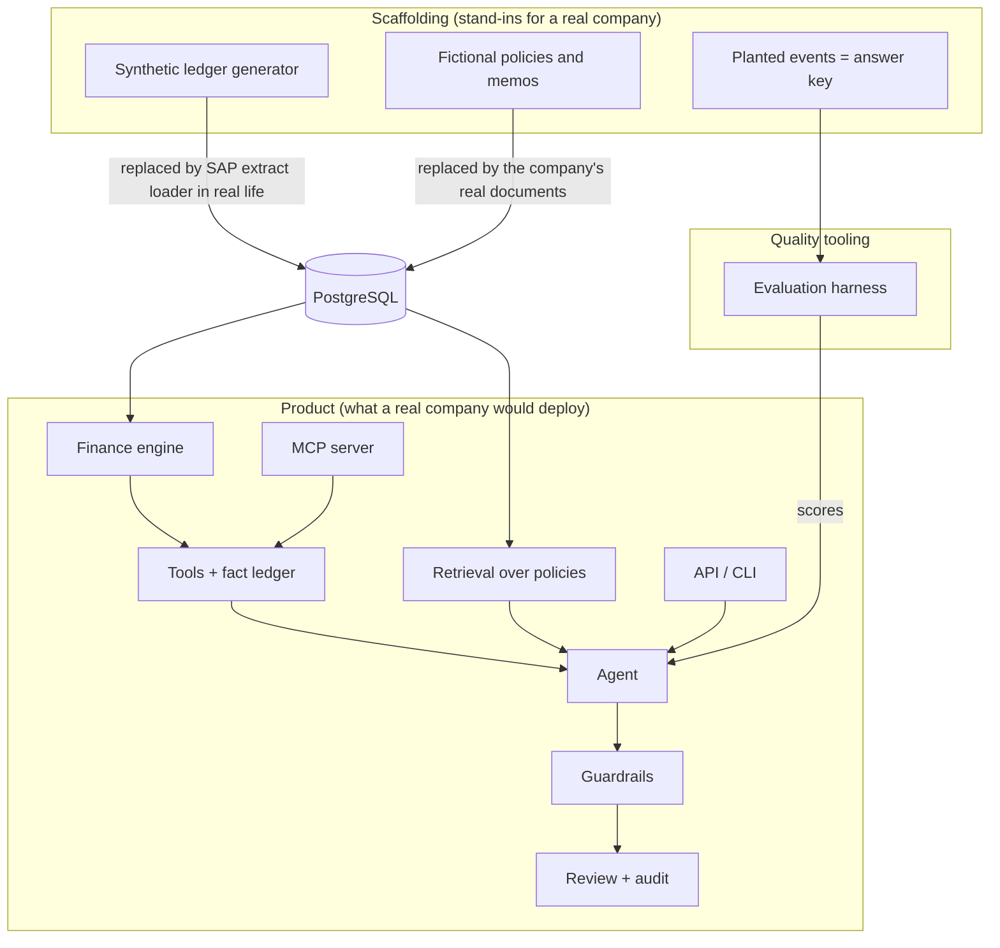
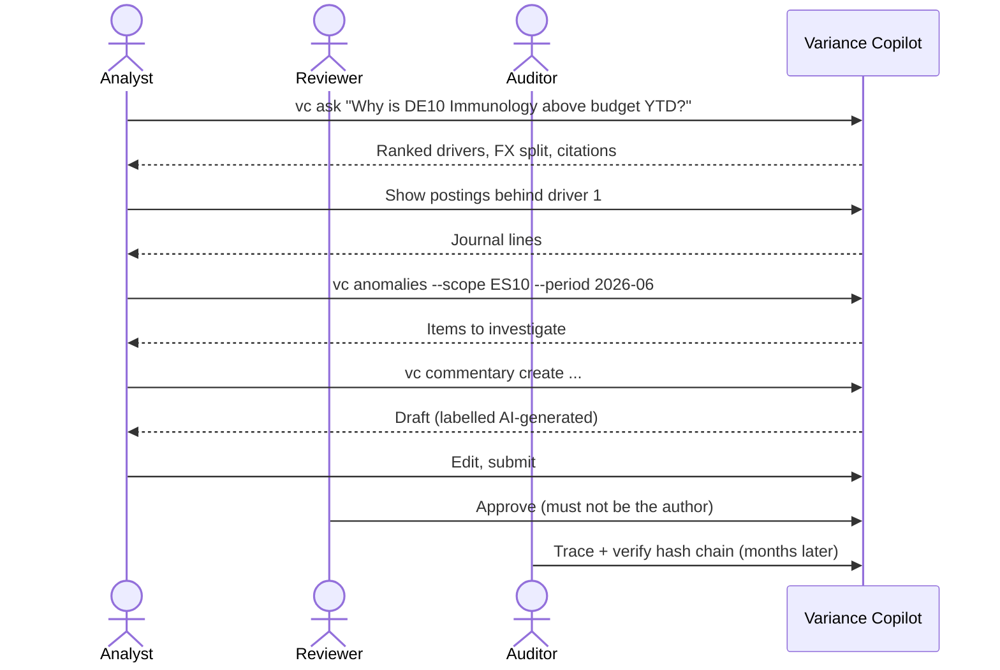
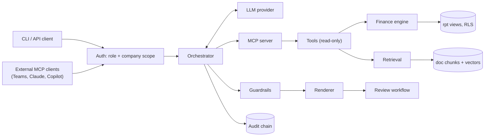

# 00 Overview

**Status:** Design · **Spec:** §1–§6 · **Decisions:** [ADR-009](../docs/adr/0009-mcp-tool-layer.md)

## In one paragraph

Variance Copilot answers the question every finance team asks after month-end close: **why are the actual results different from the plan?** A user asks in plain language ("Why are US net sales below budget year to date?"). The system runs deterministic analyses on the general ledger, finds the drivers (e.g. a product lost patent protection earlier than budgeted), links them to the relevant policy or planning memo, and writes an explanation. Every number in that explanation is computed by code, not typed by the language model, and every run leaves an audit trail. Month-end commentary drafted this way goes through human approval before anyone relies on it.

## The problem it solves

| Today | With Variance Copilot |
| --- | --- |
| Analysts click through dozens of ledger reports to find the postings behind a variance | Ask a question, get ranked drivers with drill-down to journal lines |
| Currency movements hide real performance unless someone does constant-currency maths | FX and operational effects are always separated |
| Numbers copied by hand into slides and commentary | Numbers inserted by the renderer from computed facts |
| Nobody can reconstruct how an explanation was produced | Every run has a verifiable audit chain |

Generic AI chat assistants fail here because they invent numbers, cannot show evidence and ignore access rights. The whole design is built around those three failures.

## Product vs scaffolding

The spec mixes the product with the things needed to build and test it without a real company.

- **Synthetic data** exists because we have no real SAP system. Its schema copies SAP S/4HANA so a real extract could be loaded into the same tables later.
- **Planted events** (e.g. "CARDIVEX lost exclusivity in May") give us a known answer key, so evaluation can check automatically whether the copilot found the right drivers.

## Where answers come from

Everything comes from PostgreSQL:

| Kind of content | Source | Produced by |
| --- | --- | --- |
| Numbers | Ledger and plan tables (`fin`) | Finance engine |
| Policy and context | Documents (`doc`) | Retrieval |
| Wording, ranking, classification | — | LLM (no facts of its own) |

Limit: the ledger shows **what** moved; documents add **why** only if the reason is written down somewhere. Otherwise the copilot must say the cause is not in the data.

## Who uses it and how

| Role | Typical use |
| --- | --- |
| FP&A analyst | Asks questions, drills to evidence, reviews anomalies, drafts commentary |
| Controller / reviewer | Edits and approves commentary written by someone else |
| Group reporting | Same as analyst, across all entities including group totals |
| Auditor | Reads traces and verifies the audit chain; cannot ask questions |
| Admin | Ingests documents, publishes prompts; no finance data access |

A month-end session:

## The four non-negotiable principles

1. **Deterministic numbers.** The LLM never calculates and never types a number ([04](04-tools-and-fact-ledger.md), [06](06-guardrails.md)).
2. **Grounded claims.** Numbers trace to facts; policy statements cite document chunks ([07](07-retrieval.md)).
3. **Full traceability.** Append-only, hash-chained audit trail ([08](08-review-and-audit.md)).
4. **Least privilege and human control.** Read-only tools, row-level security by company, human approval ([01](01-data-model.md), [08](08-review-and-audit.md)).

## Architecture at a glance

## The fictional company

**Aurelion Pharma Group**, reporting in USD, five legal entities:

| Code | Entity | Currency | Role |
| --- | --- | --- | --- |
| CH10 | Basel | CHF | Principal: owns IP, global R&D, HQ |
| DE10 | Munich | EUR | Sales affiliate |
| ES10 | Barcelona | EUR | Sales affiliate + shared services hub |
| IE10 | Cork | EUR | Manufacturing |
| US10 | New Jersey | USD | Largest sales affiliate |

Goods flow IE10 → CH10 → sales affiliates → customers, with intercompany prices at each step. Six brands (CARDIVEX, LUMORA, IMMUVANT, ONKARIS, NEURELIS, RESPIRA), about USD 6.3bn net sales.

## Implementation notes

_Nothing built yet._
