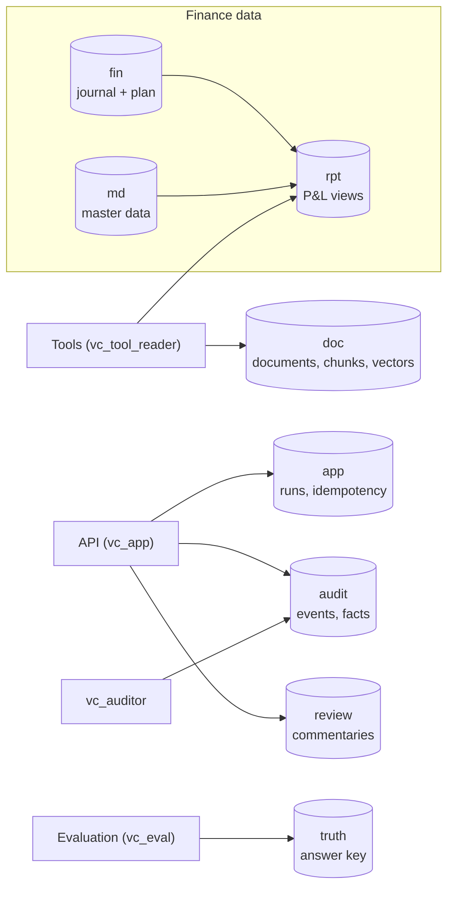
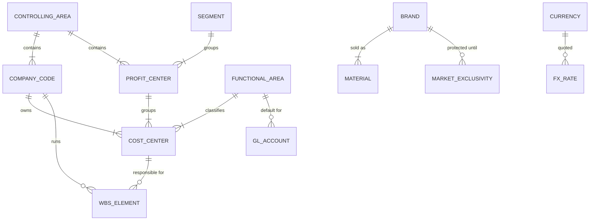
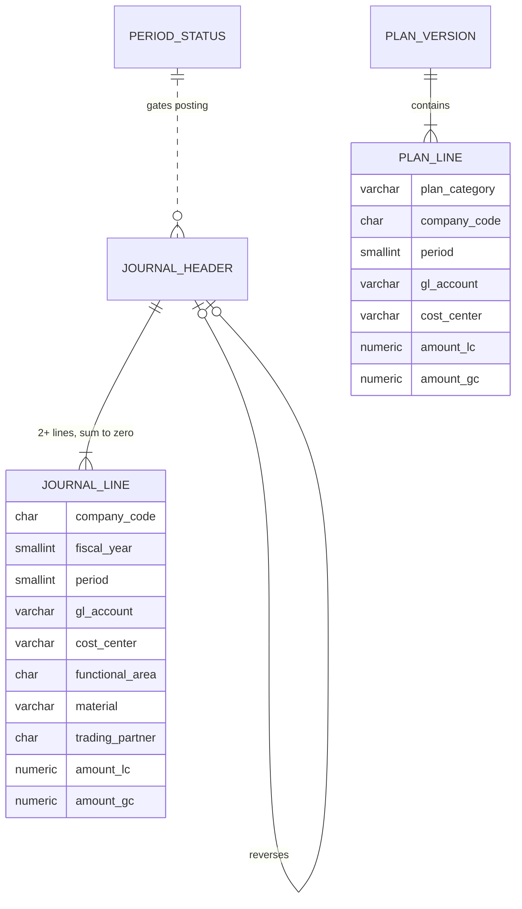
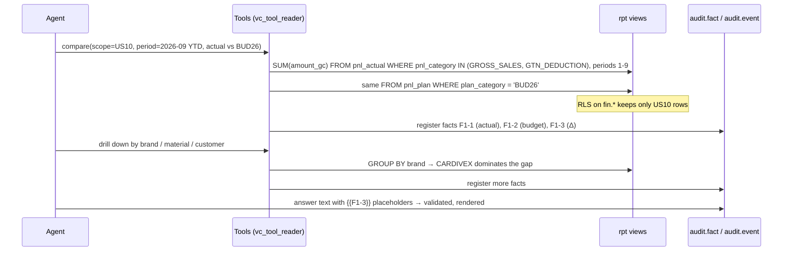
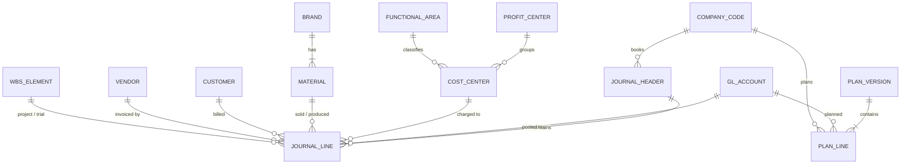
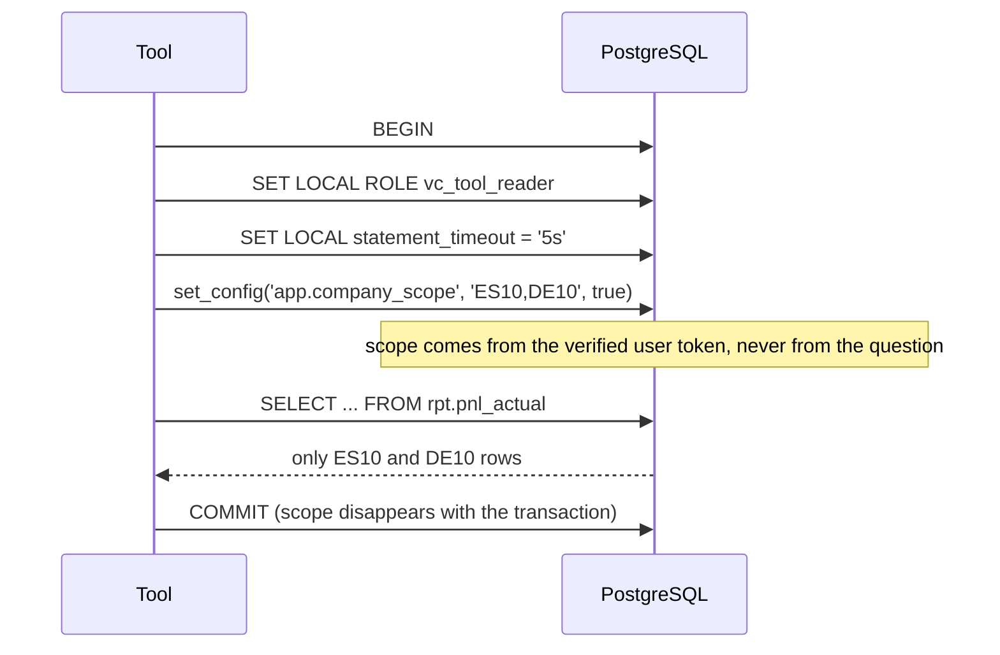
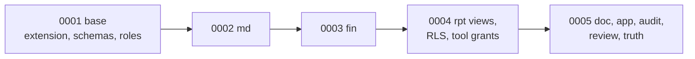

# 01 Data model

**Status:** Partial (schema built; seed data pending) · **Spec:** §7 · **Backlog:** M1-01..M1-06

## Accounting primer

The minimum finance vocabulary needed to read the rest of the docs.

| Concept | Meaning | Table |
| --- | --- | --- |
| **Journal entry (document)** | One business event, e.g. an invoice. Has a header and two or more lines | `fin.journal_header` |
| **Journal line** | One debit or credit to one account, with all the analysis dimensions | `fin.journal_line` |
| **Double entry** | Lines of a document always sum to zero: what is credited somewhere is debited elsewhere | rule I-01 |
| **GL account** | What the money is (sales, salaries, CRO costs...). Chart of accounts `AUR1` | `md.gl_account` |
| **Company code** | A legal entity with its own books (CH10, US10...) | `md.company_code` |
| **Cost center / profit center** | Who is responsible (a department / a business line) | `md.cost_center`, `md.profit_center` |
| **Functional area** | Which P&L line a cost belongs to (COGS, S&M, R&D, G&A) | `md.functional_area` |
| **Plan version** | A budget or forecast for a year (`BUD26`, `FC126`, `FC226`) | `fin.plan_version`, `fin.plan_line` |
| **Period** | Fiscal month 1–12, plus special periods 13–16 for year-end adjustments | `md.fiscal_period` |
| **Local / group currency** | The entity's own currency (EUR, CHF) vs the group's (USD) | columns `amount_lc`, `amount_gc` |
| **Trading partner** | Marks a line as intercompany (between two group entities) | `trading_partner` |

The tables mirror **SAP S/4HANA** (journal lines ≈ `ACDOCA`, plan ≈ `ACDOCP`) with readable English column names, so a real SAP extract can later be loaded into the same structure.

## Example: one billing document

US10 sells CARDIVEX to a wholesaler for USD 1,000,000 with a 2% cash discount:

| Line | Account | Debit/credit | Stored amount | Presented in P&L |
| --- | --- | --- | --- | --- |
| 1 | 11000000 Trade receivables | S (debit) | +980,000 | — (balance sheet) |
| 2 | 40130000 Cash discounts | S (debit) | +20,000 | −20,000 |
| 3 | 40000000 Gross sales | H (credit) | −1,000,000 | +1,000,000 |
| | **Sum** | | **0** | |

## Sign convention

Two conventions exist, and confusing them is a classic source of errors:

- **Stored** (ledger convention): debit positive, credit negative. Revenue is therefore stored negative.
- **Presented** (in `rpt` views and every tool output): income positive, expense negative. `presented = −stored`.

With the presented sign, a variance `Δ = Actual − Comparison` is **favourable when positive for every P&L line**, revenue or cost alike. Tools also return an explicit `favorable` flag, so the model never has to reason about signs.

## Schemas

| Schema | Contents | Who reads / writes |
| --- | --- | --- |
| `md` | Company codes, accounts, cost centers, brands, FX rates, calendar | Tools read; generator writes |
| `fin` | Journal headers and lines, plan lines, FTEs, period status | Tools read (with RLS); generator writes |
| `rpt` | Views with presentation sign and joined master data | Tools read |
| `doc` | Documents, chunks, embeddings | Retrieval reads; ingestion writes |
| `app` | Run records, idempotency keys | API |
| `audit` | Append-only events and fact ledger | API inserts only; auditors read |
| `review` | Commentaries and revisions | API |
| `truth` | Ground truth of planted events | Evaluation only, never the agent |

## Schema reference

Every table below is defined in SPEC §7.10. **Grain** means "what one row is": the single most useful thing to know about a table before querying it. The S/4HANA column says which SAP table it imitates, for anyone mapping real extracts later.

### `md`: master data (the "nouns")

Slow-changing reference data that gives meaning to the numbers. Written once by the generator; read by everything. No RLS: knowing that cost center `US10-SALES-CV` exists is not sensitive, only its amounts are.

**Organisation**

| Table | What it is | Grain | Example | S/4HANA |
| --- | --- | --- | --- | --- |
| `currency` | Currencies used and their decimal places | One currency | `USD`, `EUR`, `CHF` | TCURC |
| `controlling_area` | The management-accounting umbrella that all cost and profit centers belong to | One controlling area (there is only one) | `A000`, currency USD | TKA01 |
| `company_code` | A legal entity with its own books. Carries its local currency, its trading-partner ID for intercompany, and its role in the group | One legal entity | `ES10` Aurelion Farma S.A.U., EUR, sales affiliate + GBS hub | T001 |
| `segment` | Top-level reporting segment that profit centers roll up to | One segment | Values defined with the master-data seeds (M1-07) | FAGL_SEGM |
| `profit_center` | A business line *within* a company: company × therapeutic area. Answers "which business earned or spent this?" | One profit center | `US10CV` = US cardiovascular | CEPC / CEPCT |
| `cost_center` | A department that incurs costs. Each belongs to one company, one profit center and one functional area, which is how a salary ends up in "S&M" vs "R&D" | One department (~45 in total) | `ES10-MKT-IMM` = Spain immunology marketing → F200 | CSKS / CSKT |
| `functional_area` | The P&L line a cost belongs to in a cost-of-sales P&L | One P&L line (7) | `F300` Research and development | TFKB |

**Accounts**

| Table | What it is | Grain | Example | S/4HANA |
| --- | --- | --- | --- | --- |
| `gl_account` | The chart of accounts: *what kind* of money. Flags P&L vs balance sheet (`account_type`), the P&L category (gross sales, GTN deduction, COGS, opex…), the default functional area, and whether it is a **core adjustment** (excluded from "core" results) | One account in chart `AUR1` | `40000000` Gross sales – third party; `61070000` Clinical trial costs; `70000000` Restructuring (core adj.) | SKA1 / SKB1 / SKAT |

**Products and business partners**

| Table | What it is | Grain | Example | S/4HANA |
| --- | --- | --- | --- | --- |
| `brand` | A marketed medicine, with therapeutic area, modality and lifecycle stage | One brand (6) | `CARDIVEX`, cardiovascular, small molecule, mature | — |
| `market_exclusivity` | When a brand loses patent protection in a country (LoE), after which generics erode sales | One brand × country | CARDIVEX / US / 2026-05-01 | — |
| `material` | A sellable SKU (strength + pack) of a brand | One SKU (2–3 per brand) | `CDX-100MG-30` | MARA / MAKT |
| `customer` | Who buys: wholesalers, hospitals, tenders… plus one intercompany customer per affiliate relationship | One customer | A US wholesaler, channel `WHOLESALER` | KNA1 |
| `vendor` | Who we buy from, by category (CRO, marketing agency, licensor…) | One vendor | Meridia Clinical Research, `CRO` | LFA1 |
| `wbs_element` | A project, mainly clinical trials, so trial costs can be followed across accounts | One project | `RD-ONK-P3-01` ONKARIS Phase III | PRPS |

**Time and currency**

| Table | What it is | Grain | Example | S/4HANA |
| --- | --- | --- | --- | --- |
| `fiscal_period` | The calendar: start/end date of each period. 1–12 are months, 13–16 are year-end adjustment periods | One year × period | 2026 / 6 = June 2026 | — (fiscal year variant) |
| `fx_rate` | Exchange rates against USD, by **rate type**: monthly average (`AVG`), month-end (`CLO`), budget (`B26`), forecast (`F226`) | One rate type × currency pair × validity date | `AVG` EUR→USD from 2026-06-01 | TCURR |

### `fin`: transactions and plan (the "numbers")

Where the money is. Actuals and plans are kept in **separate tables with almost the same dimensions**, so comparing them is a matter of lining up the same columns. Protected by RLS on `company_code`.

| Table | What it is | Grain | Example | S/4HANA |
| --- | --- | --- | --- | --- |
| `period_status` | Whether each company's period is open, closing or closed, and when it closed. The generator never posts into a closed period (rule I-02) | One company × year × period | US10 / 2026 / 8 / CLOSED | OB52 |
| `journal_header` | One accounting document (invoice, payroll run, accrual…): type, dates, who entered it, currency, and a link to the document it reverses | One document | US10 / 2026 / `0090001234`, type `RV` billing | BKPF |
| `journal_line` | **The universal journal.** One debit or credit with *every* analysis dimension on the same row: account, cost/profit center, functional area, material, customer, vendor, WBS, trading partner, and the amount in three currencies (transaction, local, group). Almost every analysis starts here | One line of one document | Line 3: account 40000000, −1,000,000 USD, material CDX-100MG-30 | ACDOCA |
| `plan_version` | The list of budgets and forecasts, which FX rate type each uses, and (for forecasts) how many months are already actuals | One version (4) | `FC226` "6+6" forecast, actuals through P6, rates `F226` | ACDOCP category |
| `plan_line` | Planned amounts for one version, at the same dimensions as journal lines (minus document-level detail such as vendor, customer or line text) | One version × company × period × account × dimension combination | BUD26 / US10 / P5 / 40000000 / CDX-100MG-30 | ACDOCP |
| `stat_key_figure` | Non-financial drivers: FTE and headcount per cost center, for actuals (`ACT`) and every plan version. Used for allocations and cost-per-FTE analysis | One version × company × period × cost center × key figure | ACT / ES10 / P6 / ES10-GBS-IT / FTE / 42.5 | CO SKF |

Amounts come in three currencies on every line:

| Column | Currency | Used for |
| --- | --- | --- |
| `amount_tc` | **Transaction** currency, as on the invoice | Drill-down to the source document |
| `amount_lc` | **Local** currency of the company code | Entity-level reporting; constant-currency (FX) analysis |
| `amount_gc` | **Group** currency (USD), translated at the `AVG` rate for actuals or the version's rate type for plans | Group reporting; the default for comparisons |

### `rpt`: semantic views (what tools actually query)

Views, not tables. They join `fin` to `md`, apply the **presentation sign** (income positive) and resolve the functional area, so tool queries stay short and the sign is never got wrong in tool code. Created with `security_invoker = true`, so the RLS policies on `fin` still apply to whoever queries the view.

| View | What it is | Grain | Notes |
| --- | --- | --- | --- |
| `pnl_actual` | Actual P&L lines enriched with account name, P&L category and line, brand, channel, segment, an `is_intercompany` flag and the core-adjustment tag | One P&L journal line (balance-sheet lines filtered out) | The main source for every "actual" number |
| `pnl_plan` | The same shape for plan lines, plus `plan_category` | One P&L plan line | Filter by `plan_category` to pick BUD26, FC226… |
| `unbalanced_documents` | Documents whose lines don't sum to zero | One broken document | **Must always be empty** (rule I-01); used by tests and validation |

### `doc`: policy and memo corpus

Text for retrieval (design doc 07). No company data, so no RLS; tools may read it.

| Table | What it is | Grain | Example |
| --- | --- | --- | --- |
| `document` | One policy, procedure, planning memo or commentary example, with version, validity dates, owner, which companies it applies to, and a content hash (unchanged files are skipped on re-ingest) | One document version | `POL-005` capitalisation policy |
| `chunk` | A section-sized piece of a document with its heading path, an embedding vector (semantic search) and a full-text index (keyword search). `suspicious` marks chunks flagged by prompt-injection heuristics | One chunk | `POL-005#3`, "4 Milestones > 4.2 Capitalisation" |

### `app`: operational state

The only mutable "working" data the API keeps.

| Table | What it is | Grain |
| --- | --- | --- |
| `run` | One execution of the agent: a question, a commentary draft, an evaluation case or an external MCP session. Records who asked, their scope, model, status, tokens, cost and final output | One run |
| `idempotency_key` | Maps a client's `Idempotency-Key` header to the run it created, so retrying a request returns the same run instead of starting (and paying for) a new one | One client request key |

### `audit`: tamper-evident trail

Append-only: triggers reject `UPDATE`, `DELETE` and `TRUNCATE`; the API role can only `INSERT` and `SELECT`. Design doc 08 explains the hash chain.

| Table | What it is | Grain |
| --- | --- | --- |
| `event` | Everything that happened in a run, in order: run started, each LLM call, each tool call, facts registered, validation, completion. Each row's `row_hash` covers the previous row's hash, so editing or deleting any event breaks the chain | One event (`run_id`, `seq`) |
| `fact` | **The fact ledger.** Every number a tool computed during a run, with its kind (amount, percent, pp…), unit, a label, and provenance (which query and parameters produced it). The answer text only references these by ID (`{{F3-2}}`) | One fact in one run |

### `review`: commentary workflow

| Table | What it is | Grain |
| --- | --- | --- |
| `commentary` | A month-end commentary for a scope, period, view and comparison, and its workflow state (`DRAFT` → `IN_REVIEW` → `APPROVED`/`REJECTED`). A check constraint enforces that the approver is not the author | One commentary |
| `commentary_revision` | Each saved version of the commentary: structured content with fact placeholders, rendered Markdown, who edited it and why, and the validation result | One revision of one commentary |

### `truth`: the answer key

Scaffolding for evaluation only. Only the `vc_eval` role can see this schema, so the agent can't cheat by reading the answers.

| Table | What it is | Grain |
| --- | --- | --- |
| `scenario_event` | Each planted event (E01–E12): what happened, which companies, accounts, brands and periods it touched, how it should be classified, its exact impact versus each plan version, and the documents that carry it | One planted event |

### Database roles

| Role | Used by | Can do |
| --- | --- | --- |
| owner (`vc_owner` locally) | Migrations and the generator | Everything |
| `vc_tool_reader` | Every tool call, via `SET LOCAL ROLE` | `SELECT` on `md`, `rpt`, `doc` and the `fin` tables; `fin` rows filtered by RLS. No access to `app`, `audit`, `review`, `truth` |
| `vc_app` | API runtime | Read/write `app` and `review`; `INSERT`/`SELECT` only on `audit` |
| `vc_auditor` | Auditors | `SELECT` on `audit` |
| `vc_eval` | Evaluation runner | `SELECT` on `truth` |

### Walk-through: one question through the tables

*"Why are US net sales below budget year to date?"*, asked by `analyst_us` (scope US10) after the September close:

1. **Net sales** = gross sales + GTN deductions, which is why the tool filters by `pnl_category`, not by a single account.
2. Actual and budget come from `rpt.pnl_actual` and `rpt.pnl_plan`, which share the same columns, so the comparison is a join on dimensions.
3. Drill-down uses the dimensions on the line (`brand` via `material`, `channel` via `customer`) to find the drivers, e.g. CARDIVEX's early loss of exclusivity (`md.market_exclusivity`).
4. Every number lands in `audit.fact`; every step in `audit.event`; the run summary in `app.run`. The evaluator later checks the answer against `truth.scenario_event` (E01).

## Core entities

## Row-level security

Access control is enforced by **PostgreSQL itself**, not by the prompt. Every finance table has a policy that only shows rows whose `company_code` is in the current transaction's scope. If no scope is set, no rows are returned.

Why transaction-local: connections are pooled and reused, so a setting that outlived the transaction could leak one user's scope to another. Views use `security_invoker = true` so the policy applies to the caller, not to the view owner.

## Integrity rules

| Rule | Meaning |
| --- | --- |
| I-01 | Every document balances in local and group currency |
| I-02 | No postings into a period after it was closed |
| I-03 | Posting date falls inside its period |
| I-04 | Reversals point to their original |
| I-05 | Intercompany sales = intercompany purchases, per pair and period |
| I-06 | Group totals exclude intercompany lines |
| I-07 | No intercompany inventory build-up (simplification) |
| I-08 | Functional area follows the derivation rule |

## Implementation notes

**Schema and database access (M1-01..M1-06): built** on branch `e1-schema`.

| Part | Location |
| --- | --- |
| Migrations 0001–0005 (DDL verbatim from §7.10) | [migrations/versions/](../migrations/versions/) |
| Alembic env, `vc db migrate`, `make migrate` | [migrations/env.py](../migrations/env.py), [db/migrate.py](../src/variance_copilot/db/migrate.py) |
| S/4HANA column comments, generated from the DDL's trailing `--` comments | [db/ddl.py](../src/variance_copilot/db/ddl.py) |
| Engine (`VC_DATABASE_URL`, psycopg 3) | [db/engine.py](../src/variance_copilot/db/engine.py) |
| `tool_transaction(engine, company_scope)` | [db/session.py](../src/variance_copilot/db/session.py) |
| Tests | `tests/integration/test_*`, `tests/security/test_audit_and_grants.py`, `tests/unit/test_db.py` |

Decisions and deviations:

- **ADR-010** amends the DDL: cost center keys are `varchar(20)` (the §7.6 names are up to 14 characters), `rpt.unbalanced_documents` is `security_invoker`, `vc_tool_reader` can read `doc`, and `vc_app` gets `app` and `review`.
- Roles are cluster-wide, so 0001 creates them only if missing. Downgrade keeps a role that another database on the server still uses.
- `tool_transaction` also opens the transaction `READ ONLY`, and rejects an empty scope or anything that is not a company code. `group` is resolved to company codes by the caller (tool layer, M2).
- The login role must be able to `SET ROLE vc_tool_reader`. Locally `vc_owner` is a superuser. Deployed, grant `vc_tool_reader` to the application login.
- `VC_EMBEDDING_DIM` is read when 0005 runs. Changing it later needs a new migration.
