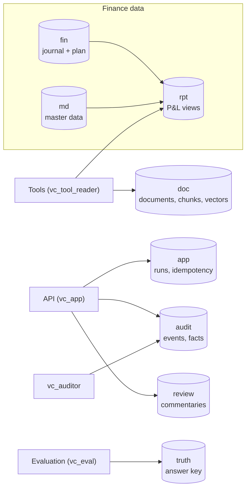
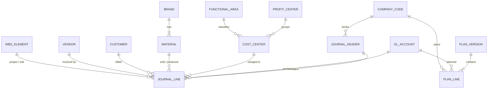
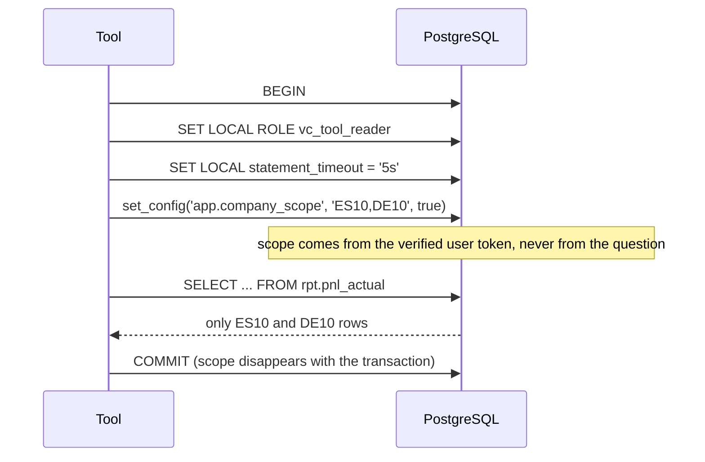

# 01 Data model

**Status:** Design · **Spec:** §7 · **Backlog:** M1-01..M1-06

## Accounting primer

The minimum finance vocabulary needed to read the rest of the docs.

| Concept | Meaning | Table |
| --- | --- | --- |
| **Journal entry (document)** | One business event, e.g. an invoice. Has a header and two or more lines | `fin.journal_header` |
| **Journal line** | One debit or credit to one account, with all the analysis dimensions | `fin.journal_line` |
| **Double entry** | Lines of a document always sum to zero: what is credited somewhere is debited elsewhere | rule I-01 |
| **GL account** | What the money is (sales, salaries, CRO costs...). Chart of accounts `AUR1` | `md.gl_account` |
| **Company code** | A legal entity with its own books (CH10, US10...) | `md.company_code` |
| **Cost center / profit center** | Who is responsible (a department / a business line) | `md.cost_center`, `md.profit_center` |
| **Functional area** | Which P&L line a cost belongs to (COGS, S&M, R&D, G&A) | `md.functional_area` |
| **Plan version** | A budget or forecast for a year (`BUD26`, `FC126`, `FC226`) | `fin.plan_version`, `fin.plan_line` |
| **Period** | Fiscal month 1–12, plus special periods 13–16 for year-end adjustments | `md.fiscal_period` |
| **Local / group currency** | The entity's own currency (EUR, CHF) vs the group's (USD) | columns `amount_lc`, `amount_gc` |
| **Trading partner** | Marks a line as intercompany (between two group entities) | `trading_partner` |

The tables mirror **SAP S/4HANA** (journal lines ≈ `ACDOCA`, plan ≈ `ACDOCP`) with readable English column names, so a real SAP extract can later be loaded into the same structure.

## Example: one billing document

US10 sells CARDIVEX to a wholesaler for USD 1,000,000 with a 2% cash discount:

| Line | Account | Debit/credit | Stored amount | Presented in P&L |
| --- | --- | --- | --- | --- |
| 1 | 11000000 Trade receivables | S (debit) | +980,000 | — (balance sheet) |
| 2 | 40130000 Cash discounts | S (debit) | +20,000 | −20,000 |
| 3 | 40000000 Gross sales | H (credit) | −1,000,000 | +1,000,000 |
| | **Sum** | | **0** | |

## Sign convention

Two conventions exist, and confusing them is a classic source of errors:

- **Stored** (ledger convention): debit positive, credit negative. Revenue is therefore stored negative.
- **Presented** (in `rpt` views and every tool output): income positive, expense negative. `presented = −stored`.

With the presented sign, a variance `Δ = Actual − Comparison` is **favourable when positive for every P&L line**, revenue or cost alike. Tools also return an explicit `favorable` flag, so the model never has to reason about signs.

## Schemas

| Schema | Contents | Who reads / writes |
| --- | --- | --- |
| `md` | Company codes, accounts, cost centers, brands, FX rates, calendar | Tools read; generator writes |
| `fin` | Journal headers and lines, plan lines, FTEs, period status | Tools read (with RLS); generator writes |
| `rpt` | Views with presentation sign and joined master data | Tools read |
| `doc` | Documents, chunks, embeddings | Retrieval reads; ingestion writes |
| `app` | Run records, idempotency keys | API |
| `audit` | Append-only events and fact ledger | API inserts only; auditors read |
| `review` | Commentaries and revisions | API |
| `truth` | Ground truth of planted events | Evaluation only, never the agent |

## Core entities

## Row-level security

Access control is enforced by **PostgreSQL itself**, not by the prompt. Every finance table has a policy that only shows rows whose `company_code` is in the current transaction's scope. If no scope is set, no rows are returned.

Why transaction-local: connections are pooled and reused, so a setting that outlived the transaction could leak one user's scope to another. Views use `security_invoker = true` so the policy applies to the caller, not to the view owner.

## Integrity rules

| Rule | Meaning |
| --- | --- |
| I-01 | Every document balances in local and group currency |
| I-02 | No postings into a period after it was closed |
| I-03 | Posting date falls inside its period |
| I-04 | Reversals point to their original |
| I-05 | Intercompany sales = intercompany purchases, per pair and period |
| I-06 | Group totals exclude intercompany lines |
| I-07 | No intercompany inventory build-up (simplification) |
| I-08 | Functional area follows the derivation rule |

## Implementation notes

_Nothing built yet._
