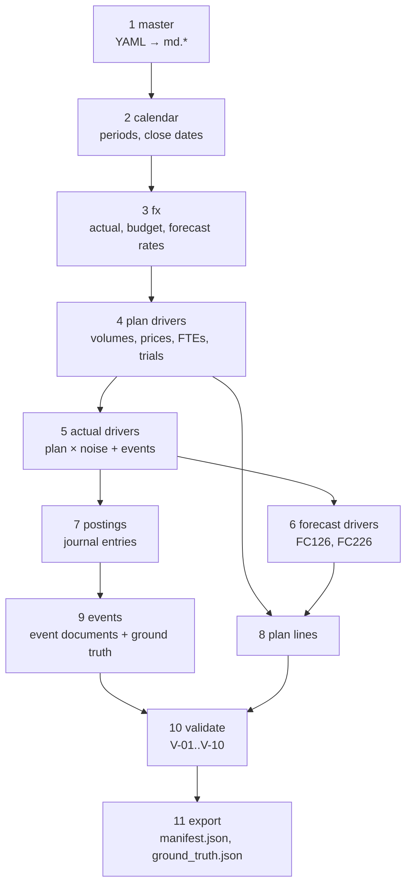
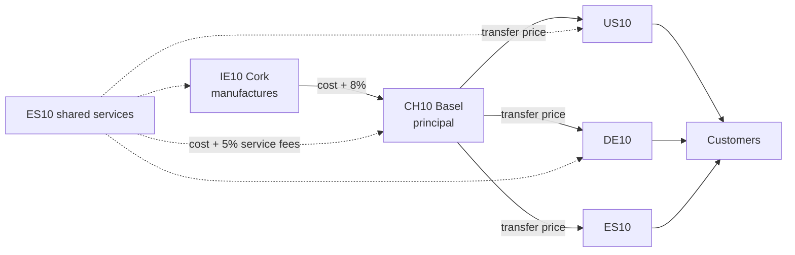
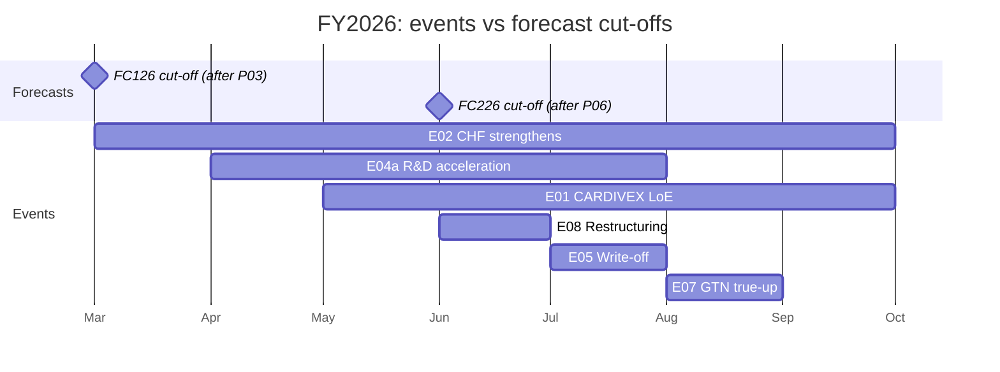

# 02 Synthetic data

**Status:** Design · **Spec:** §8 · **Backlog:** M1-07..M1-19 · **Role:** scaffolding

## Why it exists

The product needs a realistic general ledger to run on, and evaluation needs a known answer key. A real company's ledger has neither the availability nor the answer key, so we generate one:

1. **A believable ledger** for a five-entity pharma group: billing, rebates, payroll, intercompany sales, accruals, allocations.
2. **Planted scenario events** with exactly known impacts, so we can check automatically whether the copilot finds the right drivers.

In a real deployment the generator is replaced by a loader that maps SAP extracts into the same `fin` tables. Nothing downstream changes.

## Principles

| Principle | What it means |
| --- | --- |
| Deterministic | One seed → byte-identical output. Every module gets its own child random generator |
| Driver-based | Amounts come from volumes × prices, FTEs × cost per FTE, trial curves — never random amounts |
| Budget first | Budget is built from assumptions; actuals = same drivers + noise + events |
| Double-entry | Every document balances; P&L lines always have a balance-sheet offset |
| Ground truth by construction | Each event records which documents it created and its exact impact per plan version |

## Pipeline



## How revenue is generated

For each brand × country × SKU × channel × month:

```text
units  = base × SKU share × channel share × lifecycle curve × LoE erosion × seasonality × noise
gross  = units × list price
GTN    = gross × gross-to-net rate   (rebates, chargebacks, returns, discounts)
net    = gross − GTN
```

- **Lifecycle curves:** launch (S-curve), growth, mature, decline.
- **LoE erosion:** after loss of exclusivity, volume decays towards a terminal loss.
- **GTN:** US deductions 25–55% of gross, EU 5–15%. Accrued monthly, trued up quarterly.

Costs come from FTE plans (personnel), brand budgets (marketing), clinical-trial curves (R&D), asset registers (depreciation) and intercompany pricing (cost of goods).

## Intercompany flow



At group level these flows cancel out; at entity level they move profit between entities (event E10 tests this).

## Planted scenario events

| ID | What happened | Where it shows | Tests that the copilot... |
| --- | --- | --- | --- |
| E01 | CARDIVEX generics arrive 1 May, budget assumed 1 Sept | US net sales, ~−USD 300m+ | Identifies LoE, splits volume vs price |
| E02 | Swiss franc strengthens | CH10 costs in USD | Separates FX from operations |
| E03 | IMMUVANT EU launch 30% ahead | DE10/ES10 sales | Recognises launch outperformance |
| E04a | Clinical trial enrolls faster | CH10 R&D | Finds the real R&D driver |
| E04b | USD 75m milestone, **capitalised** | Balance sheet only | Does **not** blame R&D overrun on it (decoy) |
| E05 | RESPIRA batch written off | IE10 COGS, EUR 18m | Flags a one-off |
| E06 | Invoice booked to wrong cost center, fixed next month | ES10 R&D vs S&M | Spots misposting, calls it timing |
| E07 | Rebate accrual true-up for prior months | US LUMORA sales, −USD 40m | Classifies as prior-period GTN |
| E08 | Restructuring provisions | DE10, US10 | Excludes from core results |
| E09 | Congress cost booked a month late | DE10 marketing | Detects cut-off error, timing |
| E10 | Transfer price cut for ES10 | ES10 up, CH10 down | Sees zero group impact |
| E11 | Prior-year divestment gain | CH10 FY2025 | Handles prior-year comparisons |
| E12 | 25 small variances | Everywhere | Does **not** report immaterial noise |

## What each forecast knew

Forecasts only "know" events that happened before their cut-off. This lets evaluation check that answers change correctly with the comparison version.



Consequence: against `FC226`, E01 and E02 are mostly already "planned in", so variances are small; E05 and E07 were unforeseen in every version, so they stay large.

## Profiles

| Profile | Use | Size |
| --- | --- | --- |
| `ci` | CI and first build: 4 entities, FY2026 P01–P09, 5 events | 10k–15k lines |
| `dev` | Local development: everything, monthly billing | 50k–70k lines |
| `full` | Performance and demos: weekly billing | 350k–450k lines |

## Validation

Generation fails unless all checks pass: documents balance (V-01), no postings into closed periods (V-02), dates in period (V-03), reversals linked (V-04), intercompany agrees (V-05), functional areas correct (V-06), FY2025 calibration within ±3% (V-07), event impacts match the manifest (V-08), decoys stay immaterial (V-09), same seed reproduces the same checksums (V-10).

## Implementation notes

_Nothing built yet._
