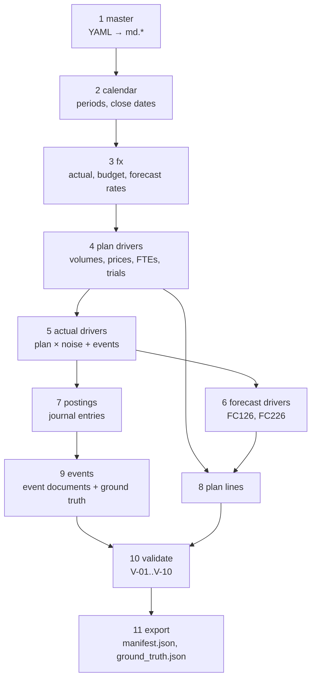
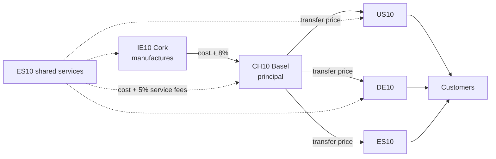
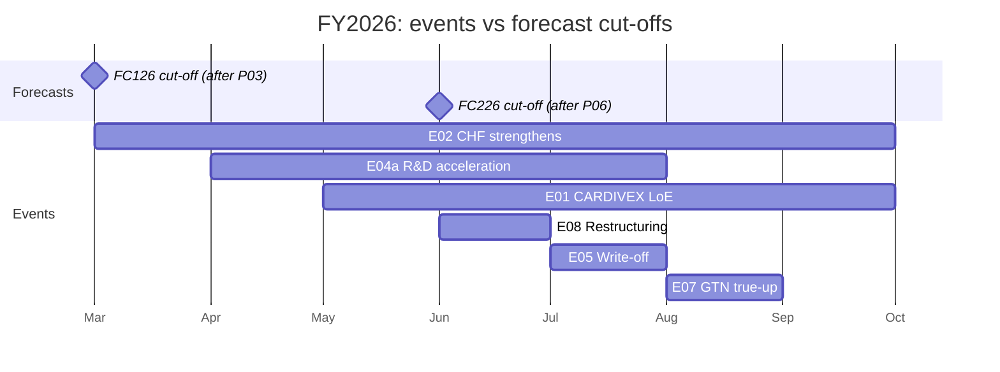
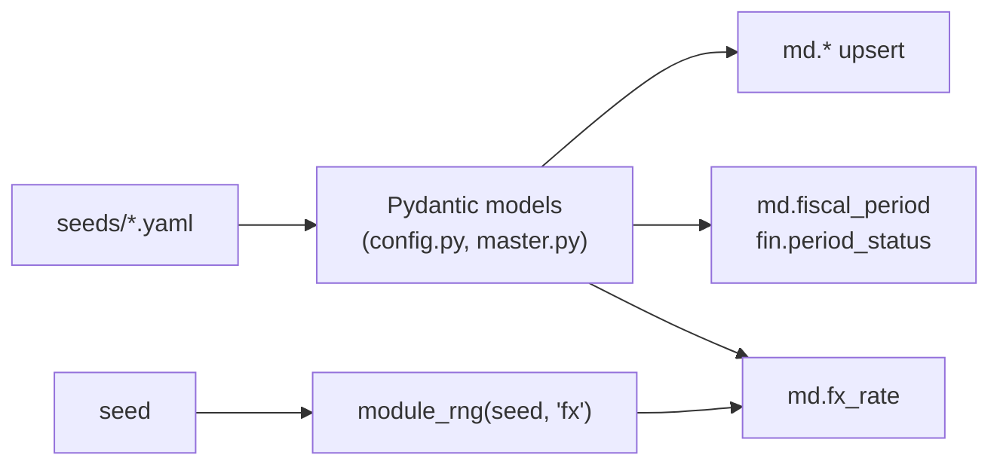
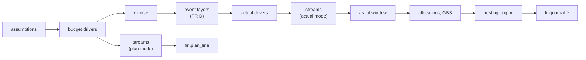

# 02 Synthetic data

**Status:** Partial (steps 1-5, 7, 8 built) · **Spec:** §8 · **Backlog:** M1-07..M1-19 · **Role:** scaffolding

## Why it exists

The product needs a realistic general ledger to run on, and evaluation needs a known answer key. A real company's ledger has neither the availability nor the answer key, so we generate one:

1. **A believable ledger** for a five-entity pharma group: billing, rebates, payroll, intercompany sales, accruals, allocations.
2. **Planted scenario events** with exactly known impacts, so we can check automatically whether the copilot finds the right drivers.

In a real deployment the generator is replaced by a loader that maps SAP extracts into the same `fin` tables. Nothing downstream changes.

## Principles

| Principle | What it means |
| --- | --- |
| Deterministic | One seed → byte-identical output. Every module gets its own child random generator |
| Driver-based | Amounts come from volumes × prices, FTEs × cost per FTE, trial curves — never random amounts |
| Budget first | Budget is built from assumptions; actuals = same drivers + noise + events |
| Double-entry | Every document balances; P&L lines always have a balance-sheet offset |
| Ground truth by construction | Each event records which documents it created and its exact impact per plan version |

## Pipeline



## How revenue is generated

For each brand × country × SKU × channel × month:

```text
units  = base × SKU share × channel share × lifecycle curve × LoE erosion × seasonality × noise
gross  = units × list price
GTN    = gross × gross-to-net rate   (rebates, chargebacks, returns, discounts)
net    = gross − GTN
```

- **Lifecycle curves:** launch (S-curve), growth, mature, decline.
- **LoE erosion:** after loss of exclusivity, volume decays towards a terminal loss.
- **GTN:** US deductions 25–55% of gross, EU 5–15%. Accrued monthly, trued up quarterly.

Costs come from FTE plans (personnel), brand budgets (marketing), clinical-trial curves (R&D), asset registers (depreciation) and intercompany pricing (cost of goods).

## Intercompany flow



At group level these flows cancel out; at entity level they move profit between entities (event E10 tests this).

## Planted scenario events

| ID | What happened | Where it shows | Tests that the copilot... |
| --- | --- | --- | --- |
| E01 | CARDIVEX generics arrive 1 May, budget assumed 1 Sept | US net sales, ~−USD 300m+ | Identifies LoE, splits volume vs price |
| E02 | Swiss franc strengthens | CH10 costs in USD | Separates FX from operations |
| E03 | IMMUVANT EU launch 30% ahead | DE10/ES10 sales | Recognises launch outperformance |
| E04a | Clinical trial enrolls faster | CH10 R&D | Finds the real R&D driver |
| E04b | USD 75m milestone, **capitalised** | Balance sheet only | Does **not** blame R&D overrun on it (decoy) |
| E05 | RESPIRA batch written off | IE10 COGS, EUR 18m | Flags a one-off |
| E06 | Invoice booked to wrong cost center, fixed next month | ES10 R&D vs S&M | Spots misposting, calls it timing |
| E07 | Rebate accrual true-up for prior months | US LUMORA sales, −USD 40m | Classifies as prior-period GTN |
| E08 | Restructuring provisions | DE10, US10 | Excludes from core results |
| E09 | Congress cost booked a month late | DE10 marketing | Detects cut-off error, timing |
| E10 | Transfer price cut for ES10 | ES10 up, CH10 down | Sees zero group impact |
| E11 | Prior-year divestment gain | CH10 FY2025 | Handles prior-year comparisons |
| E12 | 25 small variances | Everywhere | Does **not** report immaterial noise |

## What each forecast knew

Forecasts only "know" events that happened before their cut-off. This lets evaluation check that answers change correctly with the comparison version.



Consequence: against `FC226`, E01 and E02 are mostly already "planned in", so variances are small; E05 and E07 were unforeseen in every version, so they stay large.

## Profiles

| Profile | Use | Size |
| --- | --- | --- |
| `ci` | CI and first build: 4 entities, FY2026 P01–P09, 5 events | 10k–15k lines |
| `dev` | Local development: everything, monthly billing | 50k–70k lines |
| `full` | Performance and demos: weekly billing | 350k–450k lines |

## Validation

Generation fails unless all checks pass: documents balance (V-01), no postings into closed periods (V-02), dates in period (V-03), reversals linked (V-04), intercompany agrees (V-05), functional areas correct (V-06), FY2025 calibration within ±3% (V-07), event impacts match the manifest (V-08), decoys stay immaterial (V-09), same seed reproduces the same checksums (V-10).

## Implementation notes

**Pipeline steps 1-3 (M1-07..M1-10): built** on branch `e1-generator-base`.

| Part | Location |
| --- | --- |
| Scenario config (FX, calendar, calibration targets, E01-E12 parameters) | [seeds/scenario/fy2025_fy2026.yaml](../seeds/scenario/fy2025_fy2026.yaml), [generator/config.py](../src/variance_copilot/generator/config.py) |
| Profiles `full`, `dev`, `ci` | [seeds/profiles.yaml](../seeds/profiles.yaml) |
| Master data, one YAML block per `md` table | [seeds/master/](../seeds/master/), [generator/master.py](../src/variance_copilot/generator/master.py) |
| Calendar and period close state | [generator/calendar.py](../src/variance_copilot/generator/calendar.py) |
| FX paths | [generator/fx.py](../src/variance_copilot/generator/fx.py) |
| Random streams per module | [generator/rng.py](../src/variance_copilot/generator/rng.py) |
| Steps 1-3 entry point | `pipeline.prepare(profile)`, `pipeline.load_reference_data(conn, run)` |



Decisions:

- **Random streams are keyed by module name**: `SeedSequence(seed, spawn_key=(hash(name),))`. This is what `spawn` does internally, but it doesn't depend on the order modules are created, so adding a module never shifts another module's stream.
- **FX draws are fixed-shape**: walk steps, override noise and closing noise for every currency and month are drawn up front. Turning E02 on or off changes only CHF. The FX window always runs from `actuals_from` to `as_of`, so the rates are identical in every profile.
- **Override noise is uniform** within ±0.3%, so the E02 path is guaranteed to stay within the stated band.
- **Period status rows exist only for opened periods**: FY2025 P01-P13 closed and FY2026 P01-P09 closed, with P10 open. Unused special periods 14-16 and future periods get no row. Special period 13 closes on working day 4 of February. Working days are weekdays minus 1 January and 25 December.
- **Master data loads idempotently** with an upsert in FK order. Seeds are checked against the SPEC §7.5-§7.7 tables by parsing SPEC.md, so the two can't drift.
- **Decoys (E12) are an event entry** (`type: DECOYS`) rather than the top-level `decoys` block of the Appendix A excerpt, so every event has one shape and one ground-truth row.

**Budget, actuals and postings (M1-11..M1-14): built** on branch `e1-ledger`.

| Part | Location |
| --- | --- |
| Driver assumptions and noise parameters | `drivers:` and `noise:` in the scenario file, [generator/assumptions.py](../src/variance_copilot/generator/assumptions.py) |
| Lifecycle, LoE erosion, seasonality | [generator/curves.py](../src/variance_copilot/generator/curves.py) |
| Budget drivers (volumes, prices, GTN, TP, standard cost, FTE, spend) | [generator/plan.py](../src/variance_copilot/generator/plan.py) |
| Actual drivers: noise, then event layers | [generator/actual.py](../src/variance_copilot/generator/actual.py) |
| Proto-documents per posting pattern | [generator/streams.py](../src/variance_copilot/generator/streams.py) |
| Numbering, translation, rounding, reversal links | [generator/postings.py](../src/variance_copilot/generator/postings.py) |
| Plan versions, plan lines, FTE/headcount | [generator/plan_lines.py](../src/variance_copilot/generator/plan_lines.py) |
| In-memory build and DB load | `pipeline.build_ledger(run, layers)`, `pipeline.load_ledger(conn, run, ledger)` |



Decisions:

- **One set of posting rules for plan and actuals.** The same stream functions turn drivers into balanced proto-documents. Plan mode posts monthly by channel and keeps only P&L lines. Actual mode bills by customer, posts invoices with lags, accruals with explicit reversal entries, and quarterly GTN true-ups. Plan and actual therefore always share accounts and dimensions.
- **Calibration is analytic.** `base_bc` is solved so that the noise-free FY2025 plan equals the §8.4 targets exactly. The FY2025 actuals then differ only by noise, which is what M1-19 checks. IMMUVANT EU has no FY2025 sales, so it is calibrated to a launch-year budget (`launch_budget_lc`).
- **Opex budgets are top-down.** For each of S&M, R&D and G&A: pool = target share × group net sales − (personnel + depreciation + allocated service costs). The pool is then spread to cost centers, accounts and months by the `spend:` rules. COGS comes from standard cost ratios, freight, royalty, amortisation and IE10 manufacturing staff. Result: COGS 22.0%, S&M 25.0%, R&D 22.0%, G&A 5.0% in BUD25, and COGS 21.8% in BUD26.
- **The posting window is `as_of`.** Drivers run to the profile end. Documents posted or entered after 9 October 2026 are dropped, so P10 is open and holds only reversals, lagged invoices and weekly billing. Allocations and GBS fees are computed from the documents already in the window, so lagged invoices and reversals land in the right month.
- **Intercompany flows.** Goods are invoiced in the buyer's currency and GBS fees in EUR. Both sides translate the same transaction amount, so I-05 holds to the cent. Goods are resold in the month they arrive (I-07). IE10 buys raw materials at standard cost and issues them at standard cost, plus production variances.
- **Profit center on lines without a cost center** is `<CC><TA>` from the material's brand (IE10 → IE10MFG), or set explicitly (amortisation, GBS income).
- **Noise streams** are keyed by driver family and year (`noise.volume.2026`, ...). Invoice lags are keyed by year and period.
- **Sizes:** `ci` 12.1k lines (target 10k-15k). `dev` 37k lines against a 50k-70k target, to be tuned with M1-18. `full` is not yet sized.
- **Deferred:** FY2025 special period 13 audit adjustments (dev) and FTE key figures for FC126/FC226, which come with M1-16 forecasts.
