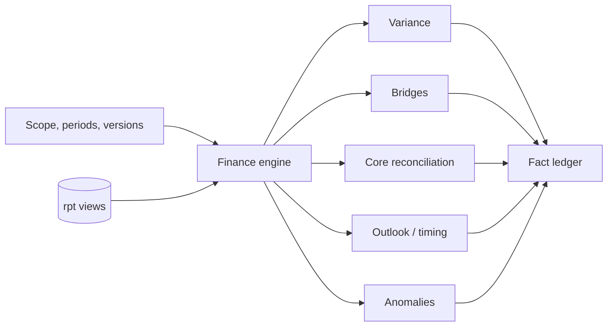
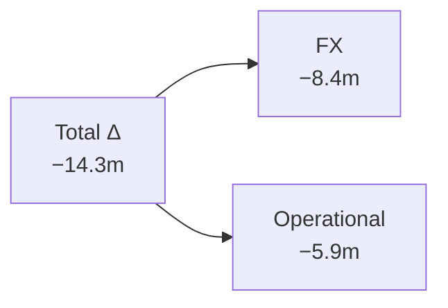
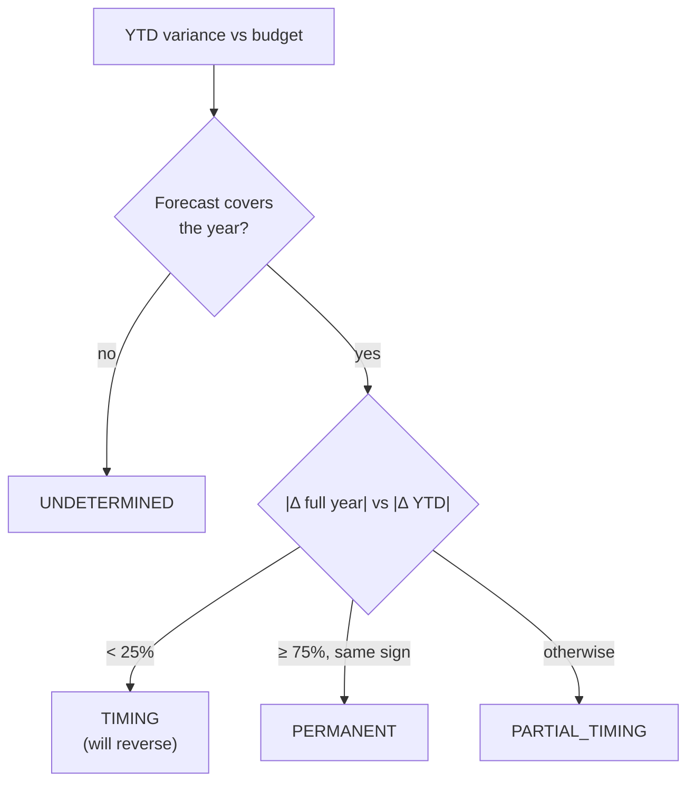

# 03 Finance engine

**Status:** Design · **Spec:** §9 · **Backlog:** M2-01..M2-09

## Role

The finance engine is the **only component that computes numbers**. It is a plain Python package (`variance_copilot.finance`) using `Decimal` arithmetic, deterministic and heavily tested. The LLM chooses which analysis to run; the engine does the arithmetic.



## Variance

```text
Δ  = Actual − Comparison                 (comparison = budget, forecast or prior year)
Δ% = Δ / |Comparison|                    (null with a warning when Comparison = 0)
favorable = Δ > 0                        (presentation sign: income +, expense −)
magnitude = UP / DOWN / FLAT             (|Actual| vs |Comparison|)
```

`favorable` and `magnitude` are different things. Costs **up** are **unfavourable**. Both flags are returned so the text can be checked for "above/below" and "favourable/adverse" independently ([06 Guardrails](06-guardrails.md)).

## FX vs operational

When an entity's currency is not USD, part of the variance is just exchange-rate movement. The engine splits it out by translating actuals at the comparison's rates (**constant currency**):

```text
A_cc  = actual in local currency × comparison rates
FX    = A_gc − A_cc                 (pure rate effect)
Δ_op  = A_cc − C_gc                 (what the business actually did)
Δ     = Δ_op + FX                   (always holds; property-tested)
```

**Worked example** — CH10 costs (presented negative):

| | CHF | Rate | USD |
| --- | --- | --- | --- |
| Budget | −100.0m | 1.18 (budget) | −118.0m |
| Actual | −105.0m | 1.26 (actual) | −132.3m |
| Actual at budget rate (CC) | −105.0m | 1.18 | −123.9m |

- Total variance: −132.3 − (−118.0) = **−14.3m**
- FX effect: −132.3 − (−123.9) = **−8.4m** (stronger franc)
- Operational: −123.9 − (−118.0) = **−5.9m** (really spent more)



This is event E02: without the split, CH10 would look much worse than it performed.

## Revenue bridge (price, volume, mix)

Decomposes a net sales variance into business causes, per brand × entity × SKU, at constant currency.

| Component | Question it answers |
| --- | --- |
| Volume | Did we sell more or fewer units? |
| Mix | Did we sell a different combination of SKUs? |
| List price | Did list prices change? |
| GTN rate | Did discounts and rebates take a bigger or smaller share? |
| GTN prior-period | One-off true-ups of earlier months' rebates (`TRUEUP-` assignment) |
| Other revenue | Royalties, collaboration income |
| FX | Currency translation |

**Worked example** — one SKU:

| | Units | Net price | Net sales |
| --- | --- | --- | --- |
| Budget | 100 | 10.0 | 1,000 |
| Actual | 90 | 9.5 | 855 |

- Volume = (90 − 100) × 10.0 = **−100**
- Price = 90 × (9.5 − 10.0) = **−45**
- Total = **−145** ✓

The components always sum exactly to the variance; the rounding residual must be below USD 1,000.


## Opex bridge

Same idea for operating expenses, per entity × functional area:

| Component | Meaning |
| --- | --- |
| FX | Rate effect |
| Personnel – FTE volume | More or fewer people than planned |
| Personnel – rate | Cost per person different |
| Non-personnel by account | Marketing, CRO, consulting, IT... |
| Allocations | Costs moved between departments |
| Other operating items | Restructuring, legal, divestments |
| Memo: one-offs | Items already inside the lines above, flagged for attention |

## Core results

Pharma companies report **core** results alongside IFRS, excluding items like amortisation, impairments, restructuring, legal settlements and divestment gains.

```text
Core operating income = IFRS operating income − (presented amounts on core-adjustment accounts)
```

A restructuring charge of −30 makes core 30 higher than IFRS; a divestment gain of +35 makes it 35 lower.

## Materiality

Only material variances get explained. Configured in `config/materiality.yaml`:

| Level | Material if |
| --- | --- |
| Group | \|Δ\| ≥ USD 10m, or \|Δ%\| ≥ 5% and \|Δ\| ≥ USD 2m |
| Entity | \|Δ\| ≥ USD 2m, or \|Δ%\| ≥ 5% and \|Δ\| ≥ USD 1m |

Drill-downs return the biggest contributors until 80% of the variance is explained (max 5).

## Timing vs permanent

Will the year-to-date variance still exist at year end? Compare it with the full-year outlook variance (latest forecast vs budget):



Reversal pairs (e.g. a misposting and its correction, E06) are always TIMING.

## Anomaly rules

Flags for a human to check, never asserted as errors:

| Rule | Detects | Example event |
| --- | --- | --- |
| A1 | Account doesn't fit the cost center's function | E06 marketing invoice on R&D |
| A2 | Vendor type doesn't fit the cost center | E06 marketing agency on medical |
| A3 | Document dated before the posting period | E09 March invoice in April |
| A4 | Reversal or reclass of an earlier period | E06 correction |
| A5 | Spike vs trailing 12 months (z > 3) | E05 write-off |
| A6 | Large round manual entry just before close | — |
| A7 | Intercompany seller/buyer mismatch | — |
| A8 | Unusual gross-to-net rate | E07 |

## Precision and formatting

- Arithmetic in `Decimal` with 28 digits; rounding only when formatting.
- Display: `USD 1.23bn`, `USD 12.3m`, `USD 456k`; `8.1%`; `2.4 pp`; `−USD 12.3m` for negatives.

## Implementation notes

_Nothing built yet._
