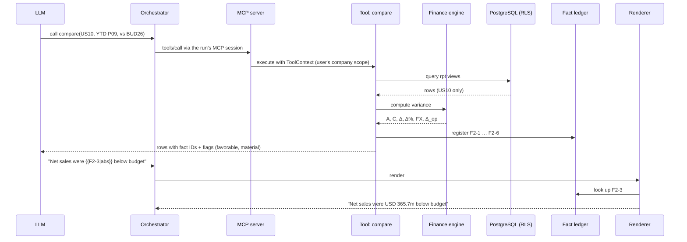
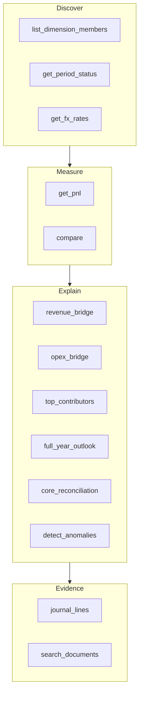
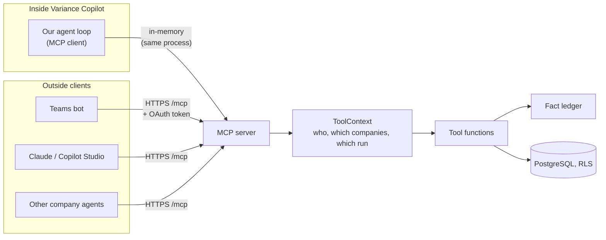
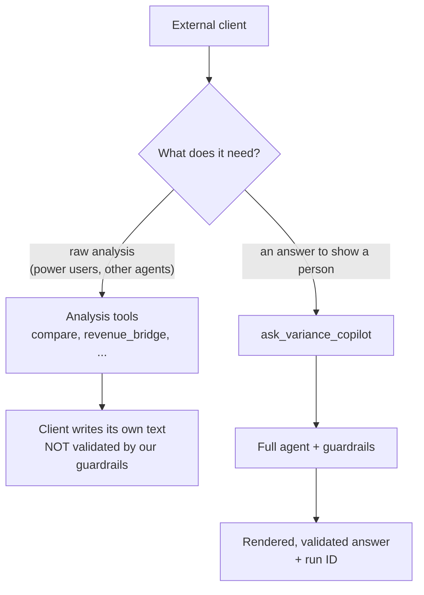
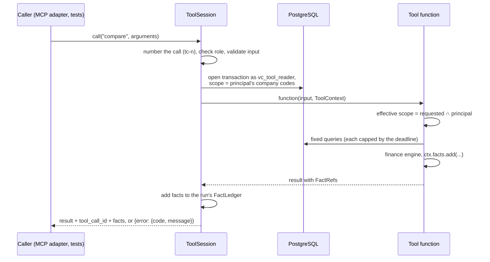

# 04 Tools and fact ledger

**Status:** Partial (M2-10..M2-12, M2-14 built) · **Spec:** §10 · **Backlog:** M2-10..M2-19 · **Decisions:** [ADR-009](../docs/adr/0009-mcp-tool-layer.md)

## The key idea

The LLM **never sees a number it is expected to copy**. Tools compute numbers, register each one as a **fact** with an ID, and return the IDs. The model writes `{{F2-3|abs}}` instead of "USD 365.7m", and the renderer substitutes the formatted value afterwards. A transcription error or an invented number becomes structurally impossible.



## What a fact looks like

```json
{
  "fact_id": "F4-12",
  "kind": "AMOUNT",
  "value": "-318412377.21",
  "unit": "USD",
  "label": "Net sales variance vs BUD26, CARDIVEX, US10, FY2026 P05-P09",
  "favorable": false,
  "magnitude": "DOWN",
  "provenance": {
    "tool_call_id": "tc-4",
    "tool": "revenue_bridge",
    "arguments_sha256": "9f2c…",
    "row_key": "brand=CARDIVEX|company_code=US10",
    "field": "delta_total"
  }
}
```

- **ID** `F<tool call>-<sequence>`, unique within a run.
- **Kinds:** AMOUNT, PERCENT, PP (percentage points), QUANTITY, RATE, COUNT.
- **Provenance** lets anyone trace a number back to the exact tool call and row. Facts are stored in `audit.fact` (append-only).

## Tool design rules

| Rule | Why |
| --- | --- |
| Read-only, run as `vc_tool_reader` with the user's company scope | A tool cannot leak or change data even if the model is manipulated |
| Typed inputs (Pydantic, enums), **no free-form SQL** | The model cannot craft arbitrary queries |
| Every number registered as a fact | Grounding becomes checkable |
| Echo the effective scope + warnings | The answer must state what it actually covered |
| Stable ordering (\|Δ\| desc, then key) | Same input → same output → reproducible tests |
| Limits: 200 journal lines, 20 contributors, 5 s query, 10 s tool | Cost and latency control |
| Errors returned as data (`error.code`) | The loop never crashes on a bad call |

Warnings: `OPEN_PERIOD` (figures preliminary), `PARTIAL_SCOPE` (some entities not visible), `NO_COMPARISON_BASE`, `TRUNCATED`, `NO_DATA`.

## Catalogue



A typical question goes: `compare` (is there a variance, is it material?) → `revenue_bridge` or `opex_bridge` (what kind?) → `top_contributors` (which brand / cost center?) → `journal_lines` or `search_documents` (evidence and policy).

## MCP: one door to the tools (ADR-009)

The tools are exposed through a **Model Context Protocol (MCP) server**, the standard protocol AI clients use to discover and call tools. Every tool call goes through it: from our own agent **and** from outside clients. There is no back door, so outside clients get exactly the behaviour our agent gets, and the tests cover both.



**How the pieces fit**

- **Tools don't know about MCP.** Each is a plain function: typed input + `ToolContext` in, typed result out. That keeps them easy to unit-test. The MCP server wraps them and generates the schemas clients see from the same Pydantic models.
- **Identity comes from the connection, never the request.** In-process, the agent's session is bound to the user the API already verified. Remotely, `/mcp` checks an OAuth bearer token, the same one the REST API accepts. A client that puts `company_scope: ["US10"]` in its arguments is ignored.
- **A remote session is a run.** It gets its own `app.run` (kind `MCP_SESSION`), fact IDs and audit events, which record which client called (e.g. "Claude 1.x").
- **Results are structured.** Each tool returns machine-readable content (rows, fact IDs, facts, scope, warnings) plus a one-line text summary, and is marked read-only.

**Two tiers, because outside clients write their own text**



Our guardrails only check text **our** agent writes. If Claude or Copilot calls `compare` and writes its own sentence, nothing stops it from rounding wrongly or inventing a cause. For answers people will rely on, clients should call `ask_variance_copilot` and show its rendered text unchanged.

## Common inputs

| Input | Values |
| --- | --- |
| `scope` | `GROUP` (group analysts only, intercompany excluded) or `COMPANY_CODE` + optional brand, segment, cost center... |
| `period` | `{fiscal_year, period, view: MTD/QTD/YTD/FY}` or a from–to range |
| `currency_basis` | `GC` (USD), `LC` (local), `CC` (constant currency) |
| `basis` | `IFRS` or `CORE` |
| versions | `ACT`, `BUD26`, `FC126`, `FC226`, `PY`, `LATEST_FC` |

## Implementation notes

### Built so far

M2-10 (fact ledger, without persistence), M2-11 (tool framework), M2-12 (data tools) and M2-14 (access tests) on branch `e2-tools`. The MCP server (M2-17), contract snapshots (M2-15) and the analysis tools (M2-13) are next.

| Module | Task | Contents |
| --- | --- | --- |
| `tools/facts.py` | M2-10 | `Fact`, `FactRef`, `Provenance`, `FactRecorder` (one call), `FactLedger` (one run), `arguments_sha256` |
| `tools/context.py` | M2-11 | `Principal`, `ToolContext`, limits, `deadline` |
| `tools/inputs.py` | M2-11 | Common inputs: `ScopeInput`, `PeriodInput`, `Version`, `CurrencyBasis`, `Basis`, `Dimension` |
| `tools/scope.py` | M2-11 | Effective scope: requested ∩ authorised, `GROUP` rules, `PARTIAL_SCOPE`, `NO_ACCESS` |
| `tools/results.py` | M2-11 | `ToolResult`, `EffectiveScope`, `ToolErrorResult` |
| `tools/session.py` | M2-11 | `Tool`, `ToolRegistry`, `ToolSession` (one per run) |
| `tools/queries.py` | M2-12 | Fixed SQLAlchemy Core statements over `rpt.*`, `fin.journal_header` and `md.*` |
| `tools/discover.py` | M2-12 | `list_dimension_members`, `get_period_status`, `get_fx_rates` |
| `tools/measure.py` | M2-12 | `get_pnl`, `compare` |
| `tools/evidence.py` | M2-12 | `journal_lines` |
| `tools/catalog.py` | M2-12 | `DATA_TOOLS`, the registry with the public names and descriptions |



### Decisions

- **One session per run.** `ToolSession` numbers calls (`tc-1`, `tc-2`, ...), opens one RLS transaction per call and keeps the run's `FactLedger`. A failed call still uses a number, and its facts are discarded.
- **The database scope is the principal's, never the input's.** The session sets `app.company_scope` to the principal's company codes. Tools also filter SQL to the effective scope, which is the requested codes that the principal may see. Only codes outside scope gives `NO_ACCESS`; some outside gives `PARTIAL_SCOPE`. The `group` claim expands to every company code (`Principal.from_claims`).
- **Roles.** Tools need `analyst`, `reviewer` or `group_analyst`; `auditor` and `admin` get `FORBIDDEN`. `GROUP` scope needs `group_analyst`, covers every company code, rejects `company_codes`, and excludes every line with a trading partner (I-06), the same rule the generator's ground truth uses.
- **Strict inputs.** Input models forbid unknown fields, so `company_scope`, `roles` or `run_id` in arguments are rejected with `INVALID_ARGUMENTS` rather than silently ignored. Every string is an enum or a pattern, except two bounded search texts (`journal_lines.text`, `list_dimension_members.filter`) that are bound parameters with `%` and `_` escaped. `group_by` maps an enum to a column name in code; no identifier comes from input. A unit test walks every input schema to enforce this.
- **Versions are an enum** (`ACT`, `PY`, `LATEST_FC`, `BUD25`, `BUD26`, `FC126`, `FC226`), as §10.1 rule 2 asks. A new plan version is therefore a contract change.
- **10-second tool timeout.** `deadline()` hooks every statement on the call's connection and sets its `statement_timeout` to the smaller of 5 s and the time left; once the budget is used up, the next statement is refused. Both paths return `TIMEOUT`.
- **Errors as data.** `FinanceError` keeps its code (`NO_FORECAST`, `MISSING_FX_RATE`, ...); validation errors become `INVALID_ARGUMENTS` without echoing the input; anything unexpected is logged and returned as `INTERNAL_ERROR` with a generic message.
- **Facts.** IDs are `F<call>-<seq>`. Variance facts (`delta`, `delta_pct`, `fx_effect`, `delta_operational`) carry `favorable` and `magnitude`. Values keep their scale, rounded half-even to ten decimals only where they have more (the scale of `audit.fact.value`). Labels read `<measure>, <row key>, <scope>, <period>, <currency basis>, <basis>`.
- **`compare` and `get_pnl`** return a `total` row next to the grouped rows, and at most 200 rows (largest |Δ| or |amount| first, then key) with `TRUNCATED` beyond that; the total always covers everything. `compare` accepts a plan version as `actual` (for example `FC226` vs `BUD26`) but not `PY`. Materiality is judged on the USD variance: the shown one for `GC` and `CC`, the group-currency one for `LC`. `LC` needs company codes with one local currency, otherwise `MIXED_CURRENCIES`. Grouping by `period` keys comparison rows by the requested period, so `PY` rows line up with the current year's.
- **Warnings.** `OPEN_PERIOD` applies to actuals only (plans are final); `NO_COMPARISON_BASE` is raised when any row's comparison is zero.
- **`journal_lines`** returns P&L lines only (`rpt.pnl_actual` joined with the header), with GC and LC amounts as facts, largest first, at most 200.
- **`list_dimension_members`** limits company-bound dimensions (company codes, cost centers, WBS elements) to the principal's companies; brands, accounts and other global master data are unrestricted.

### Not done yet

- Persisting facts to `audit.fact` with the `FACTS_REGISTERED` event waits for the audit writer (M5-01), as the M2-10 criterion states.

### Test coverage

- Unit: fact numbering, provenance and scale; scope rules; session error mapping, numbering and timeout (on SQLite); a schema walk proving there are no free-text inputs except the two search fields; no transport imports in `tools/`.
- Integration (`ci` profile): the §10.4 contract shape with values checked against direct SQL; repeatable output; `Δ = Δ_op + FX` on every row; LC, PY, CORE, period grouping; journal-line cap and filters; `PARTIAL_SCOPE`, `NO_DATA`, `OPEN_PERIOD`; FX rates and period status; the deadline cancelling a running statement.
- Security (M2-14): an ES10 analyst sees no US10 rows through any tool or filter (document number, account, text); SQL payloads in free text are only text; SQL or scope in structured fields is rejected; tools run as `vc_tool_reader` with the principal's scope even after injection attempts; group totals equal third-party lines; and seeding `ci` with and without E10 gives identical group figures while ES10's change.

- 2026-10-12 — [ADR-009](../docs/adr/0009-mcp-tool-layer.md): tools exposed through an MCP server; the orchestrator is an MCP client (in-memory transport). Moved from post-v1 roadmap into M2 (tasks M2-17..19).
