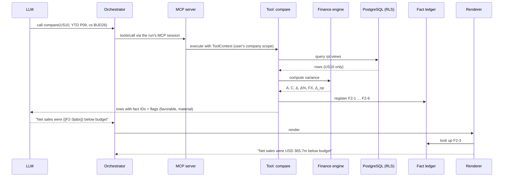
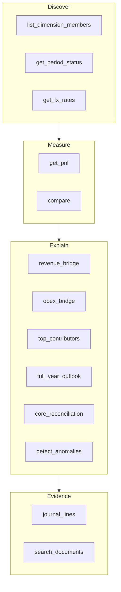
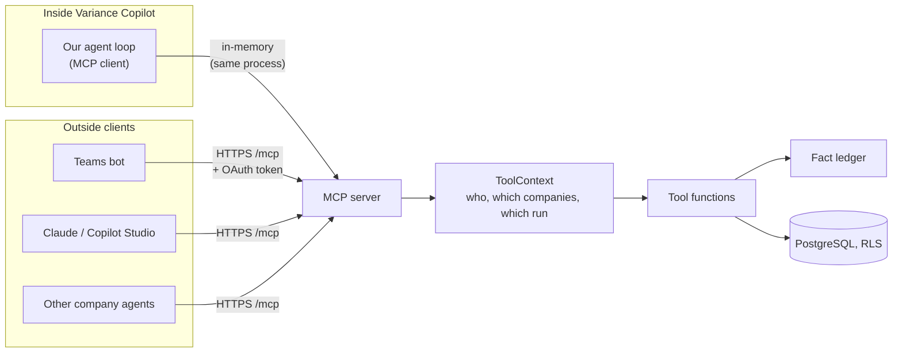
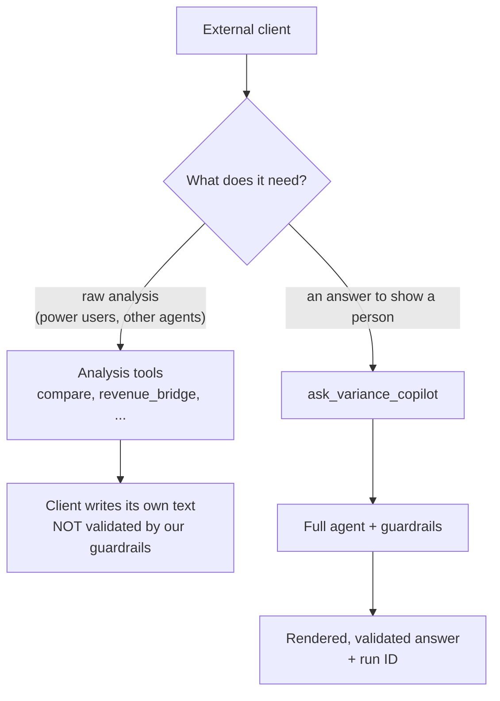

# 04 Tools and fact ledger

**Status:** Design · **Spec:** §10 · **Backlog:** M2-10..M2-19 · **Decisions:** [ADR-009](../docs/adr/0009-mcp-tool-layer.md)

## The key idea

The LLM **never sees a number it is expected to copy**. Tools compute numbers, register each one as a **fact** with an ID, and return the IDs. The model writes `{{F2-3|abs}}` instead of "USD 365.7m", and the renderer substitutes the formatted value afterwards. A transcription error or an invented number becomes structurally impossible.



## What a fact looks like

```json
{
  "fact_id": "F4-12",
  "kind": "AMOUNT",
  "value": "-318412377.21",
  "unit": "USD",
  "label": "Net sales variance vs BUD26, CARDIVEX, US10, FY2026 P05-P09",
  "favorable": false,
  "magnitude": "DOWN",
  "provenance": {
    "tool_call_id": "tc-4",
    "tool": "revenue_bridge",
    "arguments_sha256": "9f2c…",
    "row_key": "brand=CARDIVEX|company_code=US10",
    "field": "delta_total"
  }
}
```

- **ID** `F<tool call>-<sequence>`, unique within a run.
- **Kinds:** AMOUNT, PERCENT, PP (percentage points), QUANTITY, RATE, COUNT.
- **Provenance** lets anyone trace a number back to the exact tool call and row. Facts are stored in `audit.fact` (append-only).

## Tool design rules

| Rule | Why |
| --- | --- |
| Read-only, run as `vc_tool_reader` with the user's company scope | A tool cannot leak or change data even if the model is manipulated |
| Typed inputs (Pydantic, enums), **no free-form SQL** | The model cannot craft arbitrary queries |
| Every number registered as a fact | Grounding becomes checkable |
| Echo the effective scope + warnings | The answer must state what it actually covered |
| Stable ordering (\|Δ\| desc, then key) | Same input → same output → reproducible tests |
| Limits: 200 journal lines, 20 contributors, 5 s query, 10 s tool | Cost and latency control |
| Errors returned as data (`error.code`) | The loop never crashes on a bad call |

Warnings: `OPEN_PERIOD` (figures preliminary), `PARTIAL_SCOPE` (some entities not visible), `NO_COMPARISON_BASE`, `TRUNCATED`, `NO_DATA`.

## Catalogue



A typical question goes: `compare` (is there a variance, is it material?) → `revenue_bridge` or `opex_bridge` (what kind?) → `top_contributors` (which brand / cost center?) → `journal_lines` or `search_documents` (evidence and policy).

## MCP: one door to the tools (ADR-009)

The tools are exposed through a **Model Context Protocol (MCP) server**, the standard protocol AI clients use to discover and call tools. Every tool call goes through it: from our own agent **and** from outside clients. There is no back door, so outside clients get exactly the behaviour our agent gets, and the tests cover both.



**How the pieces fit**

- **Tools don't know about MCP.** Each is a plain function: typed input + `ToolContext` in, typed result out. That keeps them easy to unit-test. The MCP server wraps them and generates the schemas clients see from the same Pydantic models.
- **Identity comes from the connection, never the request.** In-process, the agent's session is bound to the user the API already verified. Remotely, `/mcp` checks an OAuth bearer token, the same one the REST API accepts. A client that puts `company_scope: ["US10"]` in its arguments is ignored.
- **A remote session is a run.** It gets its own `app.run` (kind `MCP_SESSION`), fact IDs and audit events, which record which client called (e.g. "Claude 1.x").
- **Results are structured.** Each tool returns machine-readable content (rows, fact IDs, facts, scope, warnings) plus a one-line text summary, and is marked read-only.

**Two tiers, because outside clients write their own text**



Our guardrails only check text **our** agent writes. If Claude or Copilot calls `compare` and writes its own sentence, nothing stops it from rounding wrongly or inventing a cause. For answers people will rely on, clients should call `ask_variance_copilot` and show its rendered text unchanged.

## Common inputs

| Input | Values |
| --- | --- |
| `scope` | `GROUP` (group analysts only, intercompany excluded) or `COMPANY_CODE` + optional brand, segment, cost center... |
| `period` | `{fiscal_year, period, view: MTD/QTD/YTD/FY}` or a from–to range |
| `currency_basis` | `GC` (USD), `LC` (local), `CC` (constant currency) |
| `basis` | `IFRS` or `CORE` |
| versions | `ACT`, `BUD26`, `FC126`, `FC226`, `PY`, `LATEST_FC` |

## Implementation notes

_Nothing built yet._

- 2026-10-12 — [ADR-009](../docs/adr/0009-mcp-tool-layer.md): tools exposed through an MCP server; the orchestrator is an MCP client (in-memory transport). Moved from post-v1 roadmap into M2 (tasks M2-17..19).
