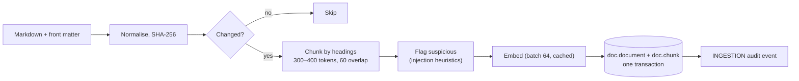
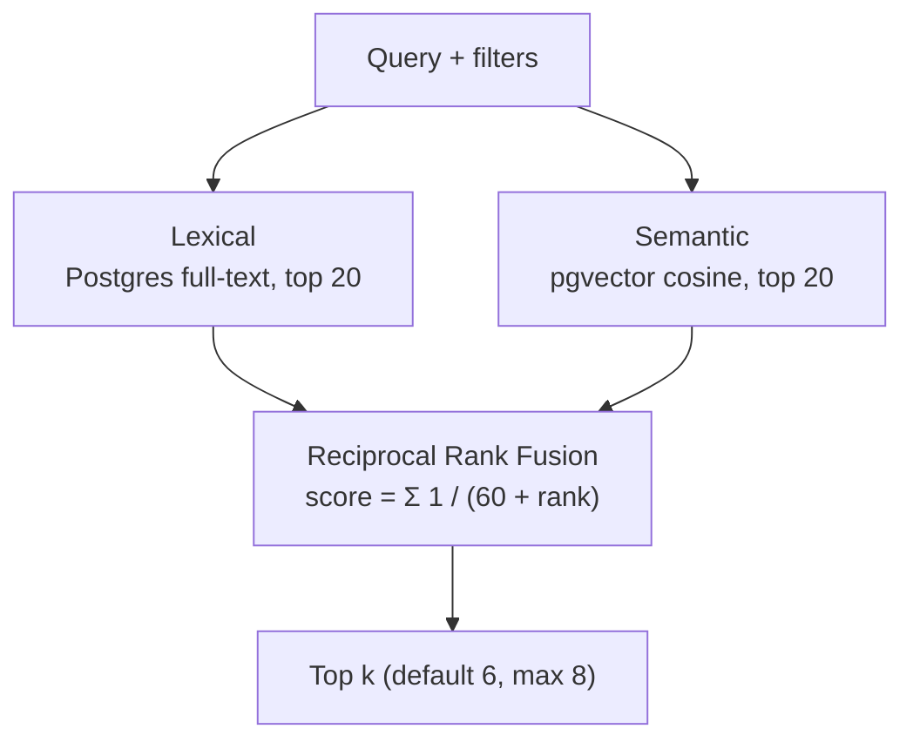

# 07 Retrieval

**Status:** Design · **Spec:** §11 · **Backlog:** M4-01..M4-09

## Role

Numbers explain **what** moved; documents explain **why** it matters and **how it is accounted for**. Retrieval finds the relevant passages so the model can cite them, e.g. "the milestone was capitalised under POL-005 §4.2".

The retrieval machinery is product. The document **content** in this repo is fictional scaffolding that a real company would replace with its own policies and memos.

## Corpus

| Type | Documents | Purpose |
| --- | --- | --- |
| Policies | POL-001..008 (revenue/GTN, FX, core results, commentary standards, R&D and milestones, cost assignment, inventory, transfer pricing) | Accounting treatment |
| Procedure | PROC-001 month-end close | Cut-off and accrual rules |
| Planning memos | MEMO-BUD26, FC126, FC226, TP26 | What the plan assumed (e.g. LoE date) |
| Commentary examples | COM-2025-P12, COM-2026-P06 | Style reference |
| Reference | REF-GLOSSARY | Terms |
| Adversarial (eval only) | ADV-001 injection, ADV-002 superseded policy | Robustness tests |

**Planning memos are rendered from the same parameters as the generator**, so memo and data never contradict each other ("budget assumed CARDIVEX LoE on 1 September").

**No answer leakage:** documents must never contain event IDs or evaluation answers; CI scans for them.

## Ingestion

- Chunks keep their heading trail (`section_path`, e.g. "4 Milestones > 4.2 Capitalisation"), used for citations.
- Tables and numbered rules are never split mid-item.
- Chunk ID: `<doc_id>#<ordinal>`, e.g. `POL-005#7`.

## Hybrid search

Keyword search is good at exact terms ("TRUEUP", "IAS 38"); vector search is good at meaning ("how do we treat upfront licence payments"). We run both and fuse the rankings.

Filters applied to both sides:

- **Effective dates:** only documents valid at the as-of date (so superseded ADV-002 is excluded).
- **Company scope:** group-wide documents, or ones that overlap the user's companies.
- **Doc type**, optionally.
- **Suspicious chunks** excluded by default.

RRF example: a chunk ranked 1st lexically and 3rd semantically scores 1/61 + 1/63 ≈ 0.0323; a chunk ranked 2nd in only one list scores 1/62 ≈ 0.0161.

## Citations

The model cites chunk IDs; the renderer turns `POL-005#7` into `(POL-005 §4.2)` using the last element of the section path. Every retrieval is audited (query, filters, chunk IDs, scores), and only chunks from this run's retrievals may be cited.

## Implementation notes

_Nothing built yet. Open decision OD-2 (embedding model) is resolved in M4-06._
