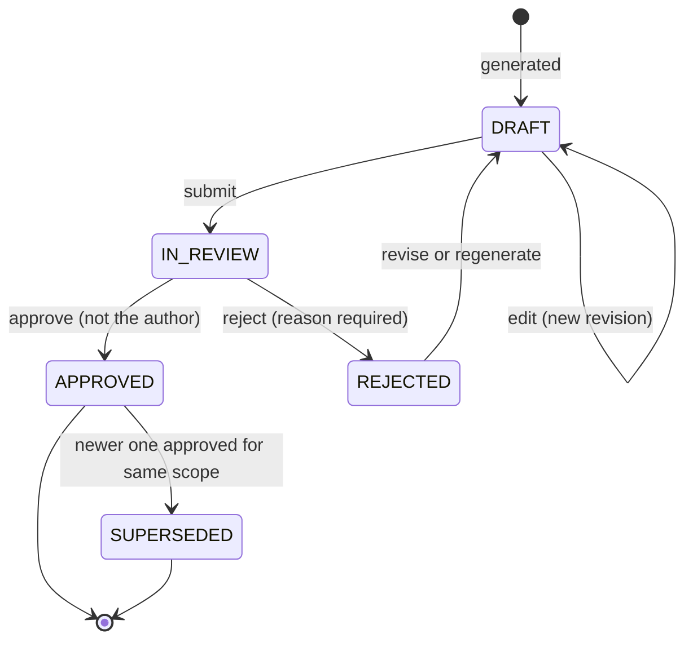
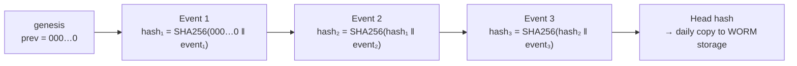

# 08 Review and audit

**Status:** Design · **Spec:** §14, §15 · **Backlog:** M5-01, M5-02, M5-10, M6-06

## Review workflow

AI-drafted commentary never goes out unreviewed. It moves through states, and a different person must approve it.

| Rule | How it is enforced |
| --- | --- |
| Approver ≠ creator | Database CHECK constraint |
| Approver ≠ any editor of the approved revision | Application check |
| Edits never overwrite | Each edit is a new revision with editor, time, reason |
| Human edits are validated too | Same grounding check; numbers must match a fact. Override only with a written justification (`VALIDATION_OVERRIDE`) |
| Approved = frozen | Corrections need a new commentary that supersedes it |
| Scope | Reviewers act only on commentaries within their companies |
| Labelling | "AI-generated draft – not reviewed" until approved; then "Reviewed and approved by X on date" |

## Audit trail

Every significant action appends one event to `audit.event`.

| Group | Events |
| --- | --- |
| Run lifecycle | `RUN_STARTED`, `SCOPE_CLASSIFIED`, `RUN_COMPLETED`, `RUN_FAILED`, `ACCESS_DENIED` |
| Inside a run | `LLM_CALL`, `TOOL_CALL`, `FACTS_REGISTERED`, `RETRIEVAL`, `VALIDATION`, `REPAIR_REQUESTED` |
| Review | `COMMENTARY_CREATED`, `REVISION_CREATED`, `SUBMITTED`, `APPROVED`, `REJECTED`, `SUPERSEDED`, `VALIDATION_OVERRIDE` |
| Admin | `INGESTION`, `PROMPT_PUBLISHED`, `CONFIG_CHANGED` |

An auditor can reconstruct any answer: which prompt version and model, which tools with which arguments, which numbers, which document chunks, what validation said, who approved.

## Tamper evidence: the hash chain

Each event's hash includes the previous event's hash. Changing or deleting any past event breaks every hash after it.

- Events are serialised with JSON Canonicalization (RFC 8785) so the same content always hashes the same.
- Inserts take an advisory lock so two writers cannot fork the chain.
- Database triggers reject UPDATE, DELETE and TRUNCATE on audit tables; the app role can only INSERT.
- `vc audit verify` recomputes the chain and reports the first break.
- The daily head-hash copy (S3 Object Lock in the AWS design) detects someone wiping and rebuilding the whole chain.

## Observability (operational, not audit)

- **Traces** (OpenTelemetry): request → run → each LLM call, tool and retrieval → database query.
- **Metrics:** runs by status, duration, tokens, cost, tool latency, validation failures, access denials.
- **Logs:** structured JSON with trace and run IDs. User questions appear in audit only, never in logs.

## Implementation notes

_Nothing built yet. Open decision OD-4 (full LLM content in production audit) is resolved in M5-10._
