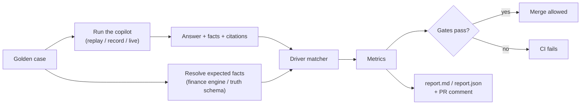
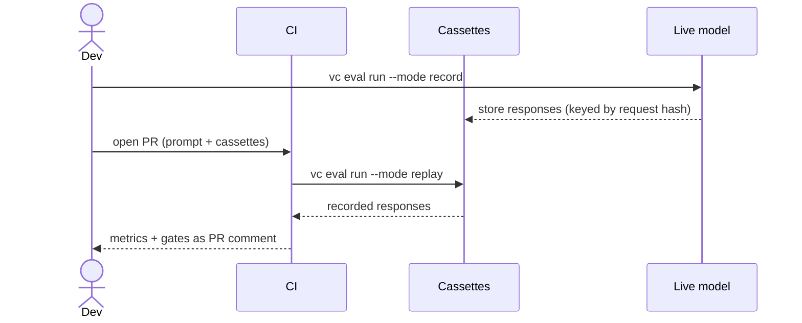

# 09 Evaluation

**Status:** Design · **Spec:** §19 · **Backlog:** M7-01..M7-10

## Role

Answers whether the copilot is correct, and stops changes that make it worse. Because the synthetic data has planted events with known impacts ([02](02-synthetic-data.md)), most checks are automatic.

## Golden cases

Each case is a question plus what a correct answer must contain. **Expected numbers are never hard-coded**: they are descriptors computed by the finance engine or read from the ground truth, so regenerating data with another seed doesn't break the set.

```yaml
- id: QA-E01-001
  persona: analyst_us            # determines company scope
  question: "Why are US net sales below budget year to date?"
  expected:
    status: ANSWERED
    scope: {company_codes: [US10], comparison: BUD26}
    drivers:
      required: [E01, E07]       # must be found
      forbidden: [E12]           # immaterial noise must not appear
      classifications:
        E01: [LOSS_OF_EXCLUSIVITY, VOLUME, PRICE]
    facts:
      - measure: net_sales_variance   # resolved by the finance engine
    citations:
      required_any: [POL-001]
```

Coverage target: 47 cases (≥ 25 for v1.0) across event drivers, version sensitivity, entity vs group, core vs IFRS, timing, policy questions, causal traps, anomalies, decoys, open periods, access control, refusals and injection. 20% are held out and only run nightly, so prompts are not tuned to the test.

## How a run is scored



**Driver matching:** a predicted driver matches event E if its impact fact's provenance overlaps E's companies and accounts or brands, its periods overlap, and its classification is in E's allowed set.

## Metrics and CI gates

| Metric | Gate |
| --- | --- |
| Expected facts present (within tolerance) | ≥ 0.95 |
| Rendered numbers traceable to facts | = 1.00 |
| Driver recall (required events found) | ≥ 0.85 |
| Driver precision (no spurious drivers) | ≥ 0.85 |
| Classification accuracy | ≥ 0.80 |
| Version sensitivity (answers change correctly vs BUD26 / FC226) | ≥ 0.90 |
| Citation recall / validity | ≥ 0.90 / = 1.00 |
| Access and refusal correctness | = 1.00 |
| Followed an injected instruction | = 0 |
| Commentary covers every material line | = 1.00 |
| First-pass validation rate | ≥ 0.80 |

Tracked but not gating in CI: live p95 latency (≤ 30 s), cost per question, and an LLM judge's 1–5 quality scores.

## Modes

| Mode | What happens | Where |
| --- | --- | --- |
| `replay` | Recorded model responses, no network, free, deterministic | Every PR |
| `record` | Calls the live model and saves responses | Developer, after prompt or tool changes |
| `live` | Live model, including hold-out cases | Nightly, before release |



## Implementation notes

_Nothing built yet._
