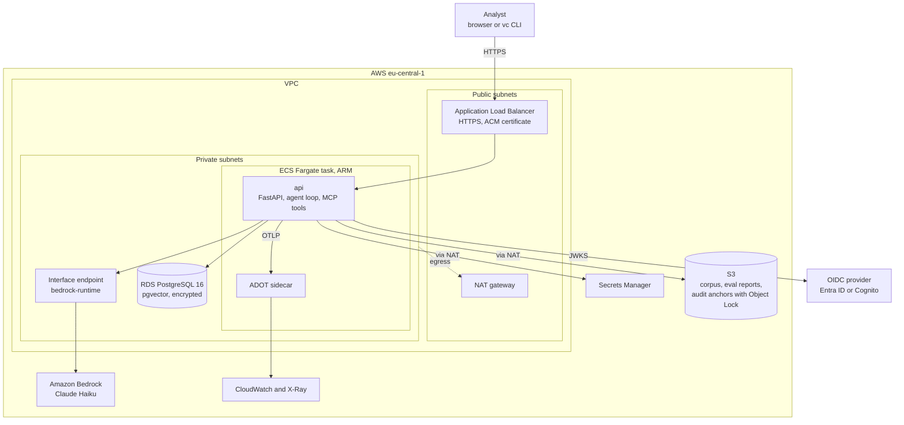
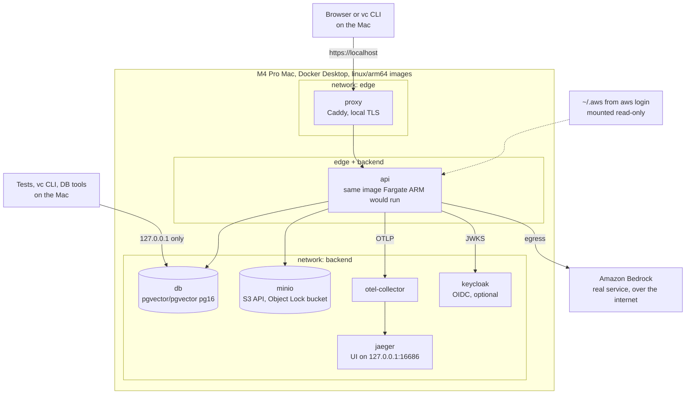

# 10 Deployment

**Status:** Design · **Spec:** §25, §26 · **Backlog:** M6-12, M6-02, M8-04, M8-06 · **Decisions:** OD-6 (CDK or Terraform) still open

For now Variance Copilot runs on our M4 Pro Mac, in Docker, laid out like the AWS reference architecture of §26. There is no Terraform or CDK until the application can be deployed (API and container image, M6); infrastructure as code stays in M8-04.

## Target: AWS reference architecture (§26)

## Now: local mirror on the M4 Pro

Only the proxy is meant to be reached from outside the Mac. Ports that development needs (database 5432, Jaeger 16686, MinIO console) are bound to `127.0.0.1`, which plays the role of a bastion or SSM tunnel into the private subnets.

## How each AWS part is imitated

| AWS (§26) | Local stand-in | Status |
| --- | --- | --- |
| VPC with public and private subnets | Docker networks: `edge` (proxy, api) and `backend` (api and everything stateful); development ports on `127.0.0.1` | Planned |
| Application Load Balancer, ACM certificate | `proxy`: Caddy reverse proxy with its own local certificate authority | Planned, with M6-12 |
| ECS on Fargate (ARM) | `api` container built for `linux/arm64`, the same image Fargate ARM would run | Planned, M6-12 |
| RDS for PostgreSQL 16 with `vector` | `db`: `pgvector/pgvector:0.8.7-pg16`, named volume | Exists |
| Bedrock through PrivateLink | Real Bedrock over the internet; credentials from `aws login`, mounted read-only into `api` | Provider exists (M3-02) |
| Secrets Manager | Git-ignored `.env`, later Compose secrets | Exists (`.env`) |
| S3 buckets, Object Lock for audit anchors | `minio` with an object-locked bucket; the corpus stays in `corpus/` on disk | Planned, M8-06 |
| ADOT sidecar to CloudWatch and X-Ray | `otel-collector` to `jaeger` | Exists |
| OIDC provider (Entra ID or Cognito) | Development tokens (`VC_AUTH_MODE=dev`); `keycloak` when OIDC itself needs testing | Planned, M6-02 |
| NAT gateway | Docker's default outbound access | Built in |
| IAM task role | The `aws login` user | Exists |

**Not imitated:** multiple availability zones, PrivateLink, IAM task roles and their least-privilege policies, autoscaling, WAF. These matter for production hardening, not for proving the product works.

**Why this mirror helps:** the `api` image, its environment variables and its network boundaries are the ones the AWS stacks will need, so M8-04 becomes a translation of a working layout rather than a design from scratch. Apple silicon builds `arm64` images natively, matching Fargate's cheaper ARM option.

**Cost:** nothing for infrastructure. The only charges are Bedrock tokens, about USD 0.06 per question on the interim Claude Haiku 4.5 (ADR-012 update).

## Implementation notes

### Built so far

`docker-compose.yml` runs `db`, `otel-collector` and `jaeger` (E0). `make up` starts them; `make down` stops them and keeps the data volume.

### Still to build

| Addition | Arrives with |
| --- | --- |
| `edge` and `backend` networks; development ports bound to `127.0.0.1` (today `5432` listens on all interfaces) | First Compose change after this doc |
| `api` service, `linux/arm64` image, `~/.aws` mounted read-only | M6-12 container image |
| `proxy` (Caddy, local TLS) in front of `api` | M6-12 |
| `keycloak` for OIDC tests | M6-02, only if `VC_AUTH_MODE=oidc` is exercised locally |
| `minio` with an object-locked bucket | M8-06 audit anchoring |

### History

- 2026-11-22: Local Docker mirror of §26 on the M4 Pro chosen over deploying to AWS now; no Terraform or CDK until M8-04. OD-6 stays open.
