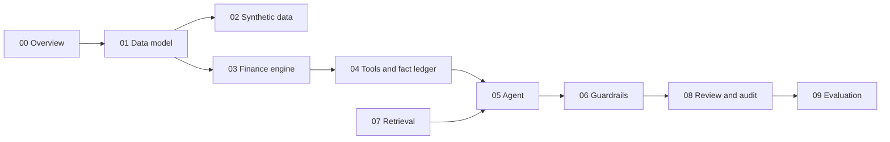

# Design docs

Personal documentation of how Variance Copilot works: what each part does, why it is built that way, and how the parts connect. [SPEC.md](../SPEC.md) is the normative source (what the system **must** do); these docs explain it in plain language with diagrams, and record what was actually built.

## How to read

Start with [00 Overview](00-overview.md), then follow the path a question takes through the system:

## Index

| Doc | Covers | Product or scaffolding | Status |
| --- | --- | --- | --- |
| [00 Overview](00-overview.md) | What the product is, who uses it, how the parts fit | — | Design |
| [01 Data model](01-data-model.md) | Ledger concepts, schemas, sign convention, row-level security | Product | Design |
| [02 Synthetic data](02-synthetic-data.md) | Generator, planted scenario events, ground truth | Scaffolding | Design |
| [03 Finance engine](03-finance-engine.md) | Variance, FX vs operational, bridges, materiality, anomalies | Product | Design |
| [04 Tools and fact ledger](04-tools-and-fact-ledger.md) | How numbers reach the model without the model typing them; MCP server | Product | Design |
| [05 Agent](05-agent.md) | Q&A loop, commentary pipeline, LLM providers, replay | Product | Design |
| [06 Guardrails](06-guardrails.md) | Placeholders, validators, scope, injection, fallback | Product | Design |
| [07 Retrieval](07-retrieval.md) | Policy corpus, ingestion, hybrid search, citations | Product (corpus content is scaffolding) | Design |
| [08 Review and audit](08-review-and-audit.md) | Approval workflow, hash-chained audit trail | Product | Design |
| [09 Evaluation](09-evaluation.md) | Golden set, replay mode, metrics and CI gates | Quality tooling | Design |

Planned once built: API and CLI, deployment, observability.

## Decisions log

| Date | ADR | Decision | Docs affected |
| --- | --- | --- | --- |
| 2026-10-12 | [ADR-009](../docs/adr/0009-mcp-tool-layer.md) | Tool layer is an MCP server; our agent is an MCP client | 00, 04, 05 |

## Conventions

- **Status:** `Design` (written from the spec, nothing built) → `Partial` → `Implemented` (matches the code).
- Each doc ends with an **Implementation notes** section: backlog tasks, code locations, and decisions or deviations made while building. Deviations from the spec also get an ADR in `docs/adr/`.
- Diagrams are Mermaid so they render on GitHub and in VS Code.
- Section references like `§9.4` point to SPEC.md.
