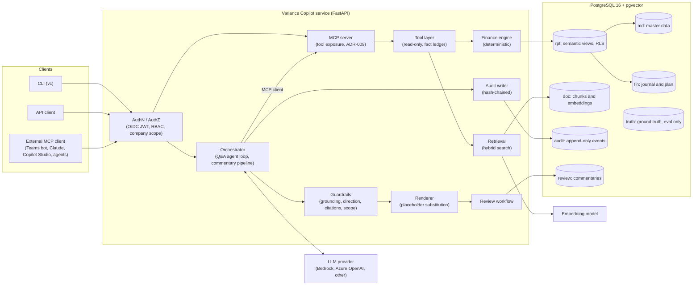

# Architecture

High-level component view of Variance Copilot. [SPEC.md §6](../SPEC.md#6-architecture) is normative; the decisions behind it are in [adr/](adr/), and [design-docs/](../design-docs/) explain each part in depth.

## Components

## Key properties

| Property | How | Decision |
| --- | --- | --- |
| Numbers are never typed by the model | Deterministic finance engine; facts inserted through placeholders | [ADR-002](adr/0002-deterministic-computation.md), [ADR-003](adr/0003-fact-placeholders.md) |
| One tool interface for every client | Tool layer exposed as an MCP server; our orchestrator is an MCP client | [ADR-009](adr/0009-mcp-tool-layer.md) |
| Access control in the database | Row-level security by company code from the verified token | [ADR-006](adr/0006-rls-by-company-code.md) |
| Every run is reconstructable | Append-only, hash-chained audit events | [ADR-005](adr/0005-hash-chained-audit.md) |
| One data store | PostgreSQL 16 + pgvector, one schema per concern | [ADR-001](adr/0001-single-postgres-pgvector-store.md) |
| Provider-independent, replayable agent | Own loop behind a provider interface; recorded responses in CI | [ADR-004](adr/0004-own-agent-loop.md), [ADR-007](adr/0007-recorded-llm-ci.md) |

## Code map

| Package (`src/variance_copilot/`) | Component |
| --- | --- |
| `api/` | FastAPI service, AuthN/AuthZ |
| `agent/` | Orchestrator (Q&A loop, providers, renderer) |
| `mcp/` | MCP server and orchestrator client |
| `tools/` | Tool layer and fact ledger |
| `finance/` | Finance engine |
| `retrieval/` | Ingestion and hybrid search |
| `guardrails/` | Validators |
| `review/` | Commentary pipeline and workflow |
| `audit/` | Hash-chained audit writer and verification |
| `generator/` | Synthetic data (scaffolding) |
| `db/` | Engine, sessions, RLS context |
| `observability/` | Tracing, metrics, logging |
| `cli.py`, `config.py` | `vc` command line; settings and YAML config |
