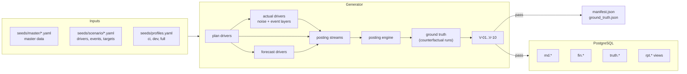
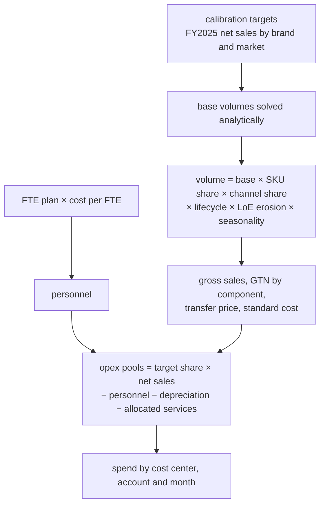

# E1 Data foundation: implementation report

| | |
| --- | --- |
| **Epic** | E1 Data foundation (M1), tasks M1-01 to M1-19 |
| **Status** | Complete; every acceptance criterion in BACKLOG.md is met |
| **Pull requests** | #3 schema, #4 generator base, #5 ledger, #6 `ci` events, and `e1-forecasts-and-events` |
| **Spec** | SPEC.md §7 (data model), §8 (seed data generator); ADR-010 amends §7.10 |
| **Design docs** | [01 Data model](../../design-docs/01-data-model.md), [02 Synthetic data](../../design-docs/02-synthetic-data.md) |

## What E1 delivers

One command builds a complete, validated, deterministic ledger of a fictional five-entity pharma group, with an answer key for evaluation:

```bash
make up && make migrate
uv run vc seed --profile ci      # 13.7k journal lines, about 6 s including all checks
uv run vc seed --profile dev     # 51.8k journal lines, about 25 s
uv run vc seed verify            # re-runs V-01..V-10 against the database
```

The result is a PostgreSQL schema mirroring SAP S/4HANA, protected by row-level security. It is filled with:

- FY2025 and FY2026 actuals;
- four plan versions (BUD25, BUD26, FC126, FC226);
- FTE and headcount key figures;
- thirteen planted scenario events, each with its exact impact against every plan version.

`generated/manifest.json` records the seed, profile, version, git commit, row counts and a SHA-256 per table. `generated/ground_truth.json` holds the answer key.



## 1. Schema and database access (M1-01..M1-06)

Five Alembic migrations hold the SPEC §7.10 DDL verbatim, one per DDL section. The trailing `--` comments in the DDL (the S/4HANA field names) become `COMMENT ON COLUMN` entries.

| Migration | Contents |
| --- | --- |
| 0001 base | `vector` extension, eight schemas, roles `vc_app`, `vc_tool_reader`, `vc_auditor`, `vc_eval` (NOLOGIN) |
| 0002 master data | 16 `md` tables: organisation, chart of accounts AUR1, cost objects, products, partners, calendar, FX |
| 0003 transactions and plan | `fin.journal_header`, `journal_line` (ACDOCA), `plan_version`, `plan_line` (ACDOCP), `stat_key_figure`, `period_status` |
| 0004 views, RLS, grants | `rpt.pnl_actual`, `rpt.pnl_plan` (income positive), `rpt.unbalanced_documents`; `company_scope` policies |
| 0005 doc, app, audit, review, truth | `doc.chunk` with `vector(VC_EMBEDDING_DIM)`, HNSW and GIN; append-only audit triggers; approver ≠ author check; `truth` for `vc_eval` only |

Tool queries run through `db.tool_transaction(engine, company_scope)`. Each one is a read-only transaction that does three things:

- `SET LOCAL ROLE vc_tool_reader`;
- a 5 s statement timeout;
- `app.company_scope`, bound as a parameter.

The settings are transaction-local, so a pooled connection never carries one user's scope into the next request.

**ADR-010** corrects three defects found in the reference DDL:

1. Cost center keys were `varchar(10)`, but the spec's own names are up to 14 characters. They are now `varchar(20)`.
2. `rpt.unbalanced_documents` was not `security_invoker` and bypassed RLS.
3. Grants were missing: `doc` for the tool reader, and `app`/`review` for the API role.

## 2. Master data and reference data (M1-07..M1-10)

| Seed | Rows | Notes |
| --- | --- | --- |
| Company codes | 5 | CH10 principal, DE10, ES10 (+ GBS hub), IE10 manufacturing, US10 |
| GL accounts | 52 | Chart AUR1 exactly as SPEC §7.5 (checked by parsing SPEC.md in a test) |
| Cost / profit centers | 45 / 27 | `<CC>-<FUNCTION>-<SUFFIX>`, all §7.6 examples present |
| Brands / materials | 6 / 14 | Lifecycle, modality and LoE dates per §7.7 |
| Customers / vendors | 23 / 23 | All fictional; a test rejects real company names |
| FX rates | 94 | AVG random walk clipped at ±4%, CLO, B25/B26 exact, F126/F226, E02 CHF override |
| Period status | per profile | FY2025 P01-P13 and FY2026 P01-P09 closed on working day 4 at 18:00 local; P10 open |

The scenario file is fully typed with Pydantic, and an invalid value fails with the path to the field. Every generator module draws from its own random stream, keyed by module name. Noise is keyed by driver family, year and company, so a company's numbers do not change when another company joins the profile.

## 3. Budget, actuals and postings (M1-11..M1-14)



- **The budget hits its targets by construction.** FY2025 BUD25 net sales equal the §8.4 targets exactly (USD 6,300m). Opex pools are sized top-down, so both budget years land on COGS 22%, S&M 25%, R&D 22% and G&A 5% (±0.2 pp).
- **Actuals are budget drivers × frozen noise** (§8.9: volume, price, GTN ±0.5 pp, spend, FTE, production variances), followed by an ordered list of event layers.
- **One set of posting rules feeds plan and actuals.** The same streams create proto-documents for both, so they always share accounts and dimensions:

| Document type | Stream |
| --- | --- |
| RV | Billing per customer, monthly (weekly in `full`) |
| ZR | GTN accruals at the planned rate; quarterly true-ups to the actual rate |
| WE, WA, RI | Intercompany chain IE10 → CH10 → affiliates; goods resold in the month received (I-07) |
| KR | Vendor invoices with 0-20 day lags; contract-currency billing for two US vendors |
| SA | Payroll on the 25th; month-end accruals with linked reversals on day 1; royalty, amortisation, bonus true-up, FY2025 P13 audit adjustment |
| AF, AL | Depreciation and service cost allocations by FTE, entered on working day 2 of the close |
| RI / KR | ES10 GBS fees at cost + 5% |

The posting engine numbers documents per company, year and type. It translates TC → LC → GC at the posting month's AVG rate, puts each rounding residual on the largest line, and links each accrual to its reversal. Plan lines aggregate the plan-mode P&L lines and translate at the version's rate type.

## 4. Scenario events and ground truth (M1-15)

Every event is a driver layer, event documents, or both. Its impact against version V is the change in (actual − V) between a full run and a run without the event. Noise is identical in both runs, so the difference is exactly the event.

| Event | Mechanics | Target (§8.8) | `dev` result | vs FC226 |
| --- | --- | --- | --- | --- |
| E01 CARDIVEX US LoE | Observed erosion from May, −12% net price from June | −300..−350m USD | −333.0m | +0.3m (known) |
| E02 CHF appreciation | CHF AVG override 1.20 → 1.26 | −30..−40m USD | −38.1m (`ci` −32.7m) | +6.0m (known) |
| E03 IMMUVANT EU launch | Volumes +30% vs budget curve | +10..+15m EUR | +13.0m | +0.1m (known) |
| E04a ONKARIS acceleration | CHF 22m change orders P04-P07; 8m pulled from P10-P12 | −22m CHF | −22.0m | −0.4m (known) |
| E04b KRB-301 milestone | USD 75m capitalised to 13000000 | zero P&L | 0 | 0 |
| E05 RESPIRA write-off | IE10 SA, EUR 18m | −18m EUR | −18.0m | −20.4m USD (unknown) |
| E06 misposting | Budgeted campaign booked to R&D, reclassed in P07 | R&D −2.4m P06, zero YTD | as target | +2.7m |
| E07 LUMORA true-up | US10 ZR USD 40m, `TRUEUP-2026P01-P07` | −40m USD | −40.0m | −40.0m (unknown) |
| E08 restructuring | DE10 EUR 14m, US10 USD 12m provisions | amounts | as configured | 0 (in FC226 actuals) |
| E09 cut-off error | March congress invoiced in April | +1.5m P03, −1.5m P04 | as target | 0 |
| E10 transfer price | ES10 TP −5% for IMMUVANT, LUMORA | zero group | ES10 +6.8m, group 0 | +0.1m (known) |
| E11 DERMAVEL divestment | CH10 FY2025 P09 gain | +35m USD | +35.0m vs BUD25 | n/a |
| E12 decoys | 25 overspends of 0.2-0.8m on distinct cost centers; NEURELIS within ±1% | immaterial | 25 planted | n/a |

Each event is written to `truth.scenario_event` with its YTD impact per version (`{"BUD26": …, "FC126": …, "FC226": …}`) and references to real documents. `ground_truth.json` adds the impact by period and by P&L line, the measured target value and, for E12, the list of decoys.

## 5. Forecasts (M1-16)

| | FC126 "3+9" | FC226 "6+6" |
| --- | --- | --- |
| Actual months | P01-P03, copied as booked | P01-P06, copied as booked |
| FX rate type | F126 = March AVG (CHF 1.20) | F226 = June AVG (CHF 1.26) |
| Known events | E02 (partly), E03 +15%, E10 | E01, E02, E03 +30%, E04a incl. pull-forward, E08, E10 |
| Opex | 50% budget phasing + 50% trailing three-month actual run-rate (trials and collaborations keep their curve) | same |

As §8.10 requires, variances against FC226 are small for E01 and E02 and full-size for E05 and E07.

## 6. Validation and outputs (M1-17, M1-18, M1-19)

| Check | What it verifies | `ci` | `dev` |
| --- | --- | --- | --- |
| V-01 | No unbalanced documents | PASS | PASS |
| V-02 | No entry after the period's close | PASS | PASS |
| V-03 | Posting dates inside the period; special periods on 31 December | PASS | PASS |
| V-04 | Reversals reference their original | PASS | PASS |
| V-05 | IC revenue = buyer expense per pair and period within USD 1 | PASS | PASS |
| V-06 | Functional area derivation on every line | PASS | PASS |
| V-07 | FY2025 net sales by brand and group ±3%, FTE by company ±5% | N/A | PASS |
| V-08 | Event impacts recomputed from the database match the manifest within 0.5% for every version, and each target range holds | PASS | PASS |
| V-09 | Decoys below 3% and below materiality (cell and YTD); NEURELIS within ±2% | N/A | PASS |
| V-10 | Regenerating in a savepoint reproduces every table checksum | PASS | PASS |

`vc seed` runs generation, load and all checks in one transaction. Any failure rolls the transaction back and prints the check ID with sample rows. CI runs `vc seed --profile ci` after the integration tests.

## 7. Code map

| Package / file | Responsibility |
| --- | --- |
| `migrations/versions/0001..0005` | DDL from SPEC §7.10 |
| `db/` | Engine, Alembic entry points, DDL comments, `tool_transaction` |
| `generator/config.py`, `assumptions.py` | Typed scenario, profiles, drivers, noise, events, targets |
| `generator/master.py`, `calendar.py`, `fx.py` | Pipeline steps 1-3 |
| `generator/curves.py`, `plan.py` | Revenue model, calibration, budget drivers |
| `generator/actual.py`, `events.py`, `forecast.py` | Noise, event layers and documents, forecasts |
| `generator/streams.py`, `postings.py`, `plan_lines.py` | Posting patterns, journal rows, plan lines, key figures |
| `generator/truth.py`, `validate.py`, `seed.py` | Ground truth, V-01..V-10, `vc seed` |

About 5,700 lines of source and 31 test modules (260 tests, 96% coverage). The tests cover:

- **Unit:** curves, calibration, noise, the integrity rules on in-memory ledgers, events and forecasts.
- **Integration:** migrations, RLS, loading, seeding.
- **Security:** audit immutability and the role grant matrix.

## 8. Decisions worth knowing

- **Contract-currency vendors.** Meridia (CRO) and Bluefield (agency) bill CH10 in USD at the budget rate, in actuals and in plans. This keeps E02 inside its range, and keeps forecasts at F226 consistent with actuals.
- **Budgeted one-offs.** The E06 launch campaign is in BUD26 (`campaigns`), so S&M under-runs by exactly what R&D over-runs.
- **E04a overrun as change orders in CHF.** This makes the −CHF 22m exact despite the USD contract.
- **Period window = `as_of`.** P10 is open and holds only documents dated up to 9 October 2026.
- **Checksums are collation-independent.** They hash `ORDER BY row::text COLLATE "C"` in UTC.

## 9. Open items

- The `full` profile builds and passes, but has 78.6k lines against the approximate 350k-450k in §8.12. No backlog criterion covers it. Reaching that size needs per-SKU delivery documents or more customers.
- E06 nets to zero in EUR; in USD about 13k remains from translating P06 and P07 at different rates.
- E02 against FC226 is +6m. This is the counterfactual's own CHF random walk between June and Q3, which no forecast could know.
