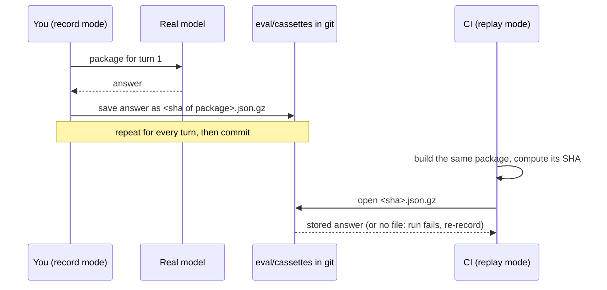

# Record and replay: testing LLM calls without an LLM

| | |
| --- | --- |
| **Spec** | §19.5; [ADR-007](adr/0007-recorded-llm-ci.md) |
| **Code** | `src/variance_copilot/agent/providers/replay.py` (M3-03), `factory.py` (M3-01) |
| **Technical notes** | [design-docs/05 Agent, Cassettes](../design-docs/05-agent.md#cassettes) |
| **Status** | Providers built. Not built yet: the eval runner (`vc eval run`, M7) and the first recordings (M3-10) |

## The idea

We test the agent on every pull request. The agent talks to an AI model, but asking the real model every time costs money, needs an API key, and gives slightly different answers each time. So we use a **notebook**:

1. **Record (once):** let the agent ask the real model, and write every question and answer into the notebook.
2. **Replay (every pull request):** never ask the model. When the agent wants to ask something, look that exact question up in the notebook and use the answer written there.
3. **Question not in the notebook?** Stop and say "re-record". We never make up an answer and never quietly call the model.

The notebook is the folder `eval/cassettes/`, committed to git.

Replay tests **our code**, not the model. In a replay run, only the model's replies come from the notebook. The loop, the tools, the database queries, the validators and the renderer all run for real.

## The three modes

| Mode | Set with | Calls the model? | Reads the notebook? | Writes the notebook? | Used by |
| --- | --- | --- | --- | --- | --- |
| record | `VC_REPLAY_MODE=record` and a live `VC_LLM_PROVIDER` | Yes, always | No | Yes, overwrites | You, after changing a prompt, a tool or the data |
| replay | `VC_REPLAY_MODE=replay` or `VC_LLM_PROVIDER=replay` | Never | Yes | No | CI on every pull request |
| live | `VC_REPLAY_MODE=off` (default) | Yes | No | No | Nightly runs, production |

`VC_LLM_MODEL` is required in all three, because the model name is part of what gets looked up.

Record and replay are **not a cache**. Record never reuses a stored answer, and replay never falls back to the model.

## What "the same question" means: the whole package

The model has no memory between calls. Every time the agent talks to it, it sends **everything again** as one package:

- the instructions (system prompt)
- the user's question
- everything said so far: the model's earlier replies and every tool result
- the list of tools
- the answer form (JSON schema)
- the model name and settings (temperature, maximum output tokens)

One user question takes several **turns**, and each turn sends a bigger package. So one question gives several notebook entries, one per turn.

## The SHA is a name, not the answer

For each package we calculate a SHA-256: a 64-character code such as `848b42ed1509…`.

- The same package always gives the same code. Change one character and you get a completely different code.
- **It is calculated from the package, before the model answers.** It cannot contain the answer.
- It is one-way: nothing can be decoded from it.

It works like a coat-check ticket. The ticket number doesn't contain your coat; it tells you which hook to look at. **The SHA is the file name, and the answer is inside the file.**

```text
eval/cassettes/848b42ed1509….json.gz     <- file name: the SHA of the package
  ├── completion       the model's answer     (what replay hands back)
  ├── request          a copy of the package  (only for debugging)
  ├── request_sha256   the SHA again          (checked against the file name)
  └── format           file format version
```

To look inside a file: `gzip -dc eval/cassettes/<sha>.json.gz | jq .`

## Worked example

An illustration with a fake model, using the real record and replay code. The question *"Why did US10 net sales miss budget?"* takes three turns. SHAs are shortened.

### A) Record

| Turn | Package contains | SHA, which is the file name | Model's answer, stored in the file |
| --- | --- | --- | --- |
| 1 | instructions, question | `848b42ed…` | call `compare` → our tool returns `F1-1 = -365.7m` |
| 2 | turn 1 contents + the `compare` call + its result | `7352eee2…` | call `get_pnl` by brand → our tool returns `F2-1 = -318.4m` |
| 3 | turn 2 contents + the `get_pnl` call + its result | `8db64de3…` | final answer: "US10 net sales were {{F1-1\|abs}} below budget, mainly CARDIVEX ({{F2-1\|abs}})." |

The model was asked 3 times, and the notebook now holds 3 files.

### B) Replay, nothing changed

The same three SHAs, all three files found, the same final answer. **The model was asked 0 more times.**

### C) Replay after adding "Be brief." to the instructions

| Turn | SHA | File? |
| --- | --- | --- |
| 1 | `f826cc50…` (new) | **missing**, so the run stops |

The instructions are in every package, so even turn 1 changes.

### D) Replay after the data changed (`compare` now returns `-366.0m`)

| Turn | SHA | File? |
| --- | --- | --- |
| 1 | `848b42ed…` | found. No tool result has been added to the package yet. |
| 2 | `35a588b1…` (new) | **missing**. The package now contains the new tool result. |



## When CI says "no recorded completion for LLM request …"

It means a package changed since recording, so the model would now see something different. The error names the SHA and the model.

1. Work out whether the change was intended (a prompt edit, a tool change, a data change). If not, see the next section.
2. Re-record with a live provider: `VC_REPLAY_MODE=record VC_LLM_PROVIDER=<live provider> VC_LLM_MODEL=<pinned model>`, then run the evaluation (`vc eval run --mode record` once M7 exists).
3. Commit the new files in the same pull request as the change. A reviewer then sees the change, the new recordings and the evaluation results together.

To see what changed, compare the package stored in an old file with the one in its re-recorded replacement:

```bash
diff <(gzip -dc eval/cassettes/<old>.json.gz | jq .request) \
     <(gzip -dc eval/cassettes/<new>.json.gz | jq .request)
```

Nothing deletes old recordings automatically yet; files nobody looks up anymore just sit there.

## What changes a package, and what doesn't

**Changes it** (re-record needed):

- any character of the instructions, the question, a tool name, description or schema, or the answer form
- the model name (`VC_LLM_MODEL`), temperature or maximum output tokens
- **any tool result.** A different seed or data profile, or a generator or finance-engine change that moves one number, invalidates every turn after the first tool call. CI must use the `ci` profile with its fixed seed.
- **list order**: tools, messages, or `["US10", "ES10"]` vs `["ES10", "US10"]`

**Does not change it:**

- the timeout (it doesn't affect the answer)
- prompt front matter (version, owner, changelog); only the prompt text counts
- other settings: cost cap, turn limits, the cassette folder
- key order inside JSON objects, spacing, temperature written `0` or `0.0`

**Traps that make replay fail randomly**, which the agent loop and tools must avoid:

- tool results that contain timestamps, durations, random IDs or rows in no fixed order
- **numbering parallel tool calls in finishing order.** Fact IDs come from the call number (`F3-…` is call 3), and the number is assigned when a call takes the session lock. Two parallel calls can swap numbers between runs, which changes the package. The loop (M3-06) must number calls in the order the model listed them and append the results in that order.

## What replay does not prove

Replay checks that our code still handles the recorded answers correctly. It cannot tell whether the model *today* would answer differently. If a vendor quietly updates the model behind a name, replay keeps passing. That's why `VC_LLM_MODEL` should name a dated model version, and why a nightly run uses the live model.

## Where things are

| What | Where |
| --- | --- |
| Package, SHA, file read and write | `agent/providers/replay.py`: `request_payload`, `request_sha256`, `CassetteStore` |
| Replay and record providers | `agent/providers/replay.py`: `ReplayProvider`, `RecordingProvider` |
| Choosing the mode from settings | `agent/providers/factory.py`: `make_llm_provider` |
| Recordings | `eval/cassettes/` (empty until M3-10) |
| Tests | `tests/unit/test_llm_providers.py` |
